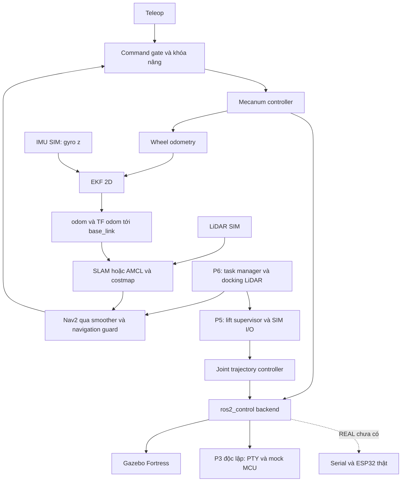

# Kế hoạch đồ án xe nâng AMR mecanum — ROS 2, Raspberry Pi 4B và ESP32

**Quyết định hiện tại — 24/10/2026:** người dùng tạm chốt MPPI; mặc định launch,
runner và recorder chuyển sang `controller:=mppi`, RPP giữ làm phương án đối chiếu
bằng `controller:=rpp`. Lượt demo Gazebo có GUI mới nhất hoàn thành 29/29:
[video MPPI](results/mppi_trial/visible_demo/mission_demo.mp4).
Người dùng yêu cầu các lần sau không tự chạy kiểm thử tránh vật cản.
Theo yêu cầu đơn giản hóa message, Serial mặc định chuyển sang **CSV từng dòng**,
230400 baud, trạng thái 20 Hz: `S,ms,tFL,tFR,tRL,tRR,lift_steps,mode,homed,lower,fault,cap`.
Lệnh `C,wFL,wFR,wRL,wRR,lift_steps,enabled`, `H` home, `D` dừng, `R` reset.
Không CRC, boot ID, sequence hoặc ACK trên dây. Bánh/nâng vẫn kiểm tra giới hạn,
homing, watchdog và giữ chính sách PWM đã chọn. ROS xác nhận bằng telemetry mới
và mode/vị trí/công tắc; uptime giảm khóa phiên, không tự chạy lại.
Đã build WROOM; 39/39 lõi ASan/UBSan, 13/13 parser CSV và 43/43 tích hợp CSV
qua PTY/lõi firmware thật đạt (gồm reset, reboot, R/F, hủy và công tắc kẹt).
23 kiểm tra giao thức v2 cũ và 11 mở cổng vẫn đạt. Test không đưa Git.
**Cần cập nhật ROS và nạp lại firmware cùng bản simple**, không trộn với firmware
`S,2,...*CRC` cũ. Chưa kiểm chứng USB thật; nếu rx_bytes=0 thì vẫn cần kiểm tra
cổng/boot/cáp. [Định dạng Serial](firmware/esp32/README.md#serial-csv-đơn-giản--mặc-định).
Chẩn đoán ESP32 trên Linux: người dùng đã nạp firmware, CP2102 ở ttyUSB0 và
baud ROS/firmware đều 230400 nhưng NO_TELEMETRY/invalid_frames=0. Đã bổ sung
nhả DTR rồi RTS khi mở cổng và RX bytes/lines/discard counters trong diagnostics;
chưa xác nhận nguyên nhân hoặc kết quả trên CP2102 thật. 11 kiểm tra mở cổng
với PTY/ioctl giả và 23 giao thức/transport đạt; không đổi firmware hoặc chính
sách PWM. [Cách kiểm tra](docs/esp32_manual_control.md#khi-báo-no_telemetry-trên-linux).
Đã thêm backend USB/UART v2 `forklift_hardware/esp32_bridge.py` và launch
`ros2 launch forklift_bringup real.launch.py port:=...` cho điều khiển thủ công
ESP32: động học bốn bánh, encoder/odometry, action nâng/home và dừng/reset.
Mặc định disarm, xác nhận handshake/ACK trước arm; giới hạn bánh 2 rad/s khớp
firmware. Khi lỗi giữ chính sách ngắt nguồn thủ công đã chọn, không tự gửi D;
Space/disarm/Ctrl+C vẫn là lệnh dừng chủ động. Bước backend ban đầu đạt **96/96 kiểm tra phần mềm**:
23 giao thức/transport/động học, 56 tích hợp launch + bàn phím qua PTY với lõi
firmware C++ thực, 17 profile base-only/khóa/thiếu hiệu chuẩn nâng và mất kết nối.
Test nằm ngoài Git ở `/tmp`; không chạy Gazebo hoặc tránh vật cản trong bước này.
Theo yêu cầu mới dùng tham số khởi đầu để tuning, firmware bật profile thử bánh
`base_bench_profile=true`, PI FL/FR/RL/RR = (0,08; 0,12; 0), trần PWM 25%,
2 rad/s, boot disarm/cần arm. Không coi các cờ điện chưa xác nhận là đã xác nhận.
Theo phương án mới đã duyệt, bật nâng một công tắc NC dưới **GPIO32** (COM–GND,
NC–GPIO32), không có công tắc trên. F/H tìm đáy, kiểm tra nhả/chạm lại rồi đặt 0;
R tới **2.000 xung từ home**, bấm nhiều lần không cộng dồn. Trần STEP 2.000,
home 30 s và budget riêng cho tìm đáy/nhả/chạm lại. Thang 200000 step/m trong
firmware/ROS là quy đổi danh nghĩa để truyền UART, **chưa đo quãng nâng thực**.
Backend báo PULSE_PRESET/chưa hiệu chuẩn; bàn phím tự nhận chế độ qua topic latched.
Space chờ ACK dừng rồi giữ vị trí đếm thực, không quay lại vị trí telemetry cũ.
Đã build WROOM (Arduino ESP32 3.3.8), **33/33** kiểm tra lõi ASan/UBSan và **33/33**
kiểm tra launch/bàn phím/firmware C++ qua PTY cho cấu hình một công tắc đạt;
25/25 phím và 17/17 nâng bằng ROS giả xác nhận chế độ SIM giữ hành vi cũ.
Test không đẩy Git; chưa nạp/thử ESP32 thật, chưa có driver MPU6050 thật/EKF trên xe.
[Hướng dẫn USB/UART và bàn phím](docs/esp32_manual_control.md).
Hiện chưa có tay cầm, dùng phím mũi tên qua `ros2 run forklift_control arrow_teleop.py`:
↑/↓ tiến/lùi, ←/→ quay, A/D hoặc Shift+mũi tên để đi ngang; R/F hoặc Page Up/Down
nâng/hạ từng 1 cm trong SIM; ESP32 pulse mode dùng R nâng preset, F/H về đáy.
Space dừng cả bánh và nâng.
Phím chữ nhận cả chữ hoa/thường; thông báo nâng nêu rõ lý do bị chặn.
Đã build và đạt 25/25 kiểm tra pseudo-terminal/di chuyển, 17/17 kiểm tra nâng với
action/service ROS giả: giới hạn chiều cao, xe dừng, homing, hủy goal muộn và
không phát lại lệnh lái sau nâng; khôi phục terminal khi thoát. Thêm 18/18 kiểm tra
từ phím terminal tới Twist/action ROS giả cho a/A, d/D, r/R, f/F, h/H. Chưa chạy
thêm chu trình Gazebo trong bước bàn phím. [Cách chạy](README.md#chạy-thủ-công-trong-mô-phỏng).
Đã tích hợp điều khiển PS4 cho SIM bằng `ps4.launch.py`: SDL game controller,
L1 cho phép lái mecanum, D-pad nâng/hạ 1 cm, Triangle home, Circle dừng.
Đã build hai package và đạt 18/18 kiểm tra bằng Joy/action/service ROS giả;
chưa có tay cầm thật kết nối để xác nhận USB/Bluetooth và ánh xạ thực tế.
[Cách chạy và bảng nút](docs/ps4_teleop.md). Không chạy thêm bài tránh vật cản.
Đã bắt đầu P2 phần mềm theo phần cứng người dùng xác nhận: ESP32 DevKit 38 chân
WROOM, 4 GA25-370 encoder khoảng 280 RPM, 4 BTS7960, TB6600/NEMA17.
Chọn MPU6050 nối Pi; phương án đầu 2 limit đã đổi sang một NC dưới GPIO32. Đã tạo
[khung firmware ESP32](firmware/esp32/README.md): PCNT, PID bốn bánh, STEP/DIR,
homing, chẩn đoán watchdog, UART v2; build cho WROOM thành công và **28/28 kiểm thử
lõi native** với ASan/UBSan đạt. [Bằng chứng và giới hạn](results/esp32_firmware/README.md).
Bản build ban đầu khóa đầu ra; bản mới bật profile thử bánh với PI dự kiến.
Backend REAL và `real.launch.py` đã được bổ sung như phần cập nhật trên; UART v1
PTY giữ nguyên, không tương thích trực tiếp v2. Chưa nạp firmware, thử bàn hay chạy xe thật;
các gate nghiệm thu phần cứng vẫn mở. Không chạy thêm kiểm thử tránh vật cản.
Thông tin bổ sung: user xác nhận encoder A/B, tỉ số truyền danh nghĩa 21,3;
PPR = 11, chọn mặc định A/B x4; đã đặt CPR danh nghĩa **937,2** với giả định
11 chu kỳ/kênh/vòng motor và bánh nối trực tiếp trục ra, chờ đo xác nhận.
chưa có E-stop/mạch ngắt. Chọn vi bước dự kiến 1/8, chưa đặt DIP; 200000 step/m hiện chỉ là giả định với lead 8 mm/vòng, chưa đo. [Diễn giải bảng motor và cách xác định thông số còn thiếu](docs/hardware_parameter_notes.md).
GPIO đã cập nhật theo dây user: FR PWM18/19 AB12/14, RR PWM21/27 AB16/4,
FL PWM23/22 AB34/35, RL PWM25/26 AB5/17; STEP13 DIR33, hai chân âm GND.
GPIO12/5 cần rà soát strapping, đặc biệt GPIO12 chọn điện áp flash lúc boot.
User chọn R_EN/L_EN kéo HIGH ngoài, không có GPIO EN. User tiếp tục chọn không
tự dừng bánh khi lỗi/mất Pi: giữ PWM cuối, ngắt nguồn thủ công; lệnh D/C-disabled
vẫn dừng được và nâng giữ bảo vệ homing/limit. E-stop/trên chưa gán (`-1`),
limit dưới đã chọn GPIO32; profile một công tắc cho phép chưa có E-stop GPIO.
PID/wiring/strapping
chưa xác minh; profile thử bánh mới dùng PI mặc định theo yêu cầu, chưa nạp.

**Thử MPPI trước quyết định chốt — 24/10/2026 (SIM):** đã giữ RPP mặc định ở thời điểm thử.
MPPI hoàn thành hai lượt độc lập lấy → mang → thả → Home, mỗi lượt 29/29.
So với baseline RPP mới, RMS khoảng cách vật lý tới path tổng thể tăng từ 3,85 cm
lên 4,45/4,66 cm: chặng có tải A–B tốt hơn, nhưng Home kém hơn. Chưa chọn MPPI
thay bộ hiện tại. Hủy khi lùi 9/9, mất LiDAR khi đang bám path 10/10, vật cản xuất
hiện trên tuyến 12/12; 64 Python và 12 trường hợp C++ đạt.
[Báo cáo, cấu hình, giới hạn và biểu đồ](results/mppi_trial/README.md).

**Đánh giá bám quỹ đạo — 24/10/2026 (SIM):** đã thử ba cấu hình Pure Pursuit,
chạy xác nhận lại cấu hình có kết quả tốt nhất và thử tinh chỉnh AMCL; cả năm lượt
hoàn thành 29/29 kiểm tra. Tuy nhiên mức giảm sai lệch vật lý chưa lặp lại ổn định,
nên đã khôi phục nguyên bản cấu hình Nav2/AMCL đã nghiệm thu. Giữ bộ đo mới để
phân biệt khoảng cách tới path, sai số điểm dừng và chênh tọa độ map/Gazebo.
[Báo cáo đầy đủ và các cấu hình bị loại](results/trajectory_tracking/README.md).
Hồi quy cấu hình được khôi phục: hủy khi lùi 9/9, mất LiDAR 10/10; 64 unit Python đạt.

> Điều hướng hiện tại chạy **path đã duyệt**, cho phép lùi theo cung trên toàn hành trình.
> Đoạn cuối thẳng vào trục pallet: A 1,30 m, B 0,90 m; rút tối thiểu 0,35 m để thoát trạm,
> sau đó tiếp tục lùi theo tuyến. Giới hạn tiến/lùi giữ 0,25/0,16 m/s.
> [Cấu hình và luồng nhiệm vụ](docs/curved_navigation.md),
> [path và quỹ đạo Gazebo](results/approved_route_sim/verified_demo_v2/route_simulation.png),
> [video](results/approved_route_sim/verified_demo_v2/mission_demo.mp4).

**Triển khai sau phê duyệt — 24/10/2026 (SIM):** chu trình lấy → mang A–B → thả → Home
đạt [29/29 kiểm tra](results/approved_route_sim/verified_demo_v2/summary.json).
Ba tuyến Nav2 dùng FollowPath với các đỉnh đã duyệt, kiểm tra costmap trước mỗi chặng;
LiDAR vẫn căn chỉnh/chèn càng. Nav2 cập nhật footprint khi mang/thả tải.
Thời gian khoảng 186 giây, RTF 98,9%; Home hướng -75° như bản xem trước.
60 unit Python và 5 kiểm tra C++ đạt. [Bằng chứng và giới hạn](results/approved_route_sim/README.md).
Hồi quy dừng: [hủy khi đang lùi 9/9](results/approved_route_sim/cancel_reverse/summary.json),
[mất LiDAR 10/10](results/approved_route_sim/scan_loss/summary.json); cả ba lượt cuối đã dọn sạch tiến trình.
Kết quả các cấu hình cũ bên dưới được giữ làm lịch sử, không cộng gộp thành nghiệm thu nhiều chu trình.

> Cập nhật CAD URDF20: mô hình mặc định đã đổi sang kích thước CAD.
> Xem [tích hợp URDF20](docs/forklift_model.md). Kết quả kiểm thử cũ bên dưới thuộc mô hình trước khi đổi CAD.

**Gate tích hợp URDF20 (SIM):** đã áp dụng kích thước CAD, build 10 package,
51/51 unit, 37/37 motion/interlock, 13/13 P6 và 10/10 hủy khi có tải.
Trước P7 cần chạy lại ma trận P6 nhiều chu trình và các lỗi còn lại cho CAD;
không dùng kết quả mô hình cũ để thay bước này. Hành trình nâng 120 mm còn tạm.

**Thống nhất mô hình:** CAD được gộp vào `forklift_description`, không còn package
`urdf20` riêng. Build hiện có 9 package; bằng chứng chuyển đổi tên/đường dẫn và
kiểm thử sau khi gộp ở `results/model_layout`. Số liệu 10 package phía trên là lịch sử
trước khi gộp. Kích thước và cấu hình vận hành giữ nguyên.

Ngày lập: **22/10/2026**. Rà soát và cập nhật: **23/10/2026**.

## 0. Kết quả rà soát P0–P5 ngày 23/10/2026

Snapshot lịch sử trước khi bắt đầu firmware; trạng thái P2 mới ngày 24/10 ở đầu trang.

**Nền tảng mô phỏng đã có điều khiển mecanum, SLAM/Nav2, EKF và nâng có giám sát. P6-SIM đã đạt chu trình lấy–giao pallet vật lý tại trạm cố định (10/10 lượt và 11/11 tình huống lỗi); chưa có firmware ESP32 hoặc nghiệm thu xe thật.** Rà soát P0–P5 dựa trên mã nguồn/kết quả đã lưu; phần P6 được cập nhật bằng các lượt chạy mới trong giai đoạn triển khai tiếp theo.

| Giai đoạn | Trạng thái thực tế | Bằng chứng chính | Phần còn thiếu |
|---|---|---|---|
| P0 | Đạt nền tảng phần mềm/G0; chưa đóng toàn bộ P0 | [Baseline 3/3](results/p0/baseline.json), [khảo sát upstream](docs/upstream_audit.md) | Số đo cơ khí, encoder, nâng, mạch điện và IMU thật |
| P1 | Đạt phạm vi SIM/G1 | [Minimal 37/37](results/p1_final/checks.json), [warehouse 37/37](results/p1_warehouse/checks.json) | Hình học/khối lượng ngoài thông số bánh vẫn là giả định SIM |
| P2 | Chưa triển khai; hoãn theo yêu cầu | Chưa có firmware ESP32 của dự án forklift | Encoder/PID, STEP/DIR, GPIO, watchdog và thử bàn |
| P3 | Đạt P3-SIM; G3 REAL chưa đạt | [PTY/mock MCU 24/24](results/p3/summary.json), [giao thức hiện có](docs/uart_protocol.md) | UART vật lý, phản hồi encoder thật, hiệu chuẩn, bringup REAL |
| P4 | Đạt phạm vi P4-SIM và tích hợp EKF | [P4 ban đầu 34/34](results/p4_final/acceptance_summary.json); [hồi quy sau P5 38/38, 10/10 đích](results/p5/navigation/acceptance_summary.json) | X4 thật, MPU6050 thật, định vị/điều hướng và profiling trên Pi |
| P5 | Đạt phạm vi P5-SIM; G5 REAL chưa đạt | [Tổng hợp P5](results/p5/summary.json): 30 lượt chiều cao mỗi điều kiện tải, ma trận lỗi 39/39 | STEP/mét, công tắc và tải thật, giữ tải khi mất nguồn; lấy/thả pallet thuộc P6 |
| P6 | Đạt G6-SIM trong mô hình trạm cố định | [Tổng hợp P6](results/p6/summary.json): 10/10 chu trình, 11/11 tình huống lỗi; có video | REAL, hàng/pallet khác mẫu và vùng khuất LiDAR chưa nghiệm thu |

Không cộng kết quả các lần hồi quy thành số phép thử độc lập. Các gate REAL vẫn mở; kết quả SIM không thay thế nghiệm thu phần cứng. [Báo cáo P0/P1](docs/p0_p1_status.md), [P3/P4](docs/p3_p4_status.md), [EKF/MPU6050-SIM](docs/ekf_mpu6050.md), [P5](docs/p5_lift.md).

## 1. Mục tiêu và cơ sở lập kế hoạch

Tên đề tài đề xuất: **Thiết kế và điều khiển robot vận chuyển hàng trong nhà sử dụng bánh mecanum và cơ cấu nâng vít me trên nền ROS 2**.

Xây dựng robot có hai chế độ mô phỏng và thực tế: điều khiển thủ công, đo tốc độ bốn bánh, lập bản đồ, tự định vị, đến đích trên RViz2 và nâng/hạ càng. Chu trình tự động lấy–giao hàng là mốc nâng cao sau khi các chức năng nền ổn định.

Cơ sở:

- Yêu cầu phần cứng và chức năng trong [Các-tính-năg-chính.docx](./Các-tính-năg-chính.docx).
- Phần gợi ý ChatGPT được đính kèm: xem như phương án tham khảo, các khẳng định kỹ thuật cần kiểm chứng.
- Repo [Trkkhrmn/ros2_amr_mecanumbot](https://github.com/Trkkhrmn/ros2_amr_mecanumbot): nguồn kế thừa mô hình, thế giới kho, cấu hình và ý tưởng nhiệm vụ.

**Kiến trúc đã áp dụng:** tạo dự án `forklift` riêng trong thư mục hiện tại, kế thừa có chọn lọc từ repo trên, dùng ROS 2 Humble + Gazebo Fortress + ros2_control làm nền tảng điều khiển. Đây vẫn là dự án phát triển dựa trên repo người dùng chọn; không sao chép nguyên trạng toàn bộ tầng Jetson/STM32/Classic.

Phạm vi đã triển khai được người dùng cho phép: P0/P1, P3/P4, bổ sung EKF với giao diện MPU6050 và P5 **chỉ trong mô phỏng**. P2, firmware ESP32 và thử xe thật được hoãn. P3 dùng MCU giả qua PTY; P4/P5 dùng Gazebo Fortress. Người dùng đã tiếp tục cho phép triển khai P6-SIM theo thiết kế kiện cao để LiDAR quan sát trực tiếp. Xem [hướng dẫn P3/P4 SIM](docs/p3_p4_simulation.md).

## 2. Những gì đã xác minh và giới hạn khảo sát

Theo [README upstream](https://github.com/Trkkhrmn/ros2_amr_mecanumbot#readme):

| Hạng mục | Hiện trạng công bố | Hướng xử lý |
|---|---|---|
| Nền tảng | Humble, Gazebo Classic 11 | Chuyển mô phỏng sang Fortress |
| Máy tính/MCU | Jetson Nano, STM32 | Thay bằng Pi 4B, ESP32 |
| Mô phỏng | Có SLAM, Nav2, nâng, nhiệm vụ | Tái kiểm chứng từng chức năng |
| Robot thật | Đã demo teleop và nâng/hạ | Tự hành thực cần phát triển, đo kiểm |
| Firmware | Parser và phần điều khiển còn stub | Viết encoder, PID, homing |
| UART | `M,w_fl,w_fr,w_rl,w_rr\n`, telemetry tùy chọn | Bổ sung phản hồi và phát hiện lỗi |
| Giấy phép | MIT | Giữ license và ghi nguồn phần kế thừa |

Khảo sát ban đầu dựa vào README và cây thư mục qua web. Trong P0 đã lấy được toàn bộ nguồn, khóa commit `385b761c8c96757d2cade890c105f1dbfe187ed4` và đọc các file liên quan. [Khảo sát mã thực tế](docs/upstream_audit.md) và [ma trận kế thừa](docs/reuse_matrix.md) ghi rõ những gì đã kiểm tra.

Máy phát triển: Ubuntu 22.04.5, x86_64, `/opt/ros/humble`, Fortress 6.17.1. Demo mecanum đã kiểm chứng sau khi sửa namespace hướng ma sát cho Fortress; mô phỏng P1 đã chạy với controller bốn bánh, nâng và LiDAR. Nav2/SLAM có cài; đã tích hợp và kiểm chứng tiếp ở P4-SIM, tách khỏi phạm vi P0/P1. [Môi trường và phiên bản](docs/environment.md).

## 3. Phạm vi và giả định

### 3.1. Bắt buộc cho bản đồ án cơ bản

- Bốn bánh mecanum: tiến/lùi, đi ngang, xoay tại chỗ và dừng.
- Bốn encoder, PID độc lập trên ESP32, giao tiếp hai chiều Pi–ESP32.
- Teleop ROS 2 và chế độ kiểm tra ESP32 qua Serial khi robot đứng trên giá thử.
- YDLiDAR X4 hiển thị `/scan`, SLAM tạo/lưu bản đồ, AMCL định vị trên bản đồ đã lưu.
- Nav2 đi tới đích do người vận hành chọn trên RViz2, xử lý vật cản trong khu thử.
- Càng nâng NEMA23 + TB6600 + vít me: homing, các mức độ cao định sẵn, giới hạn hành trình.
- Nút E-stop phần cứng, watchdog, trạng thái lỗi và khởi động lại có kiểm soát.
- Mô phỏng và robot thật dùng chung giao diện lệnh/trạng thái, có cấu hình riêng.

### 3.2. Nâng cao, chỉ làm sau khi đạt chức năng cơ bản

- Nhiệm vụ điểm lấy A → nâng → điểm giao B → hạ → về Home.
- Căn chỉnh pallet bằng cảm biến/marker nếu có camera hoặc cảm biến bổ sung.
- IMU và EKF: đã bổ sung ở SIM theo yêu cầu; driver, bias và hiệu chuẩn MPU6050 thật còn chờ giai đoạn REAL.
- Giám sát pin, GUI riêng, QR hoặc bám vạch.

QR, camera, nhận dạng pallet và lấy hàng ở vị trí bất kỳ chưa nằm trong cấu hình phần cứng đã cung cấp. Bản đầu dùng trạm và vị trí pallet cố định, có gá dẫn hướng; người vận hành xác nhận căn chỉnh khi cần. LiDAR 2D và Nav2 đến điểm đích chưa đủ chứng minh khả năng đưa càng vào pallet chính xác.

### 3.3. Thông số còn phải xác nhận ở P0

| Nhóm | Dữ liệu cần thu thập | Ảnh hưởng |
|---|---|---|
| Thời gian | Hạn nộp, số người, giờ/tuần | Điều chỉnh lịch 12 tuần bên dưới |
| Bánh/khung | Xác nhận cấu hình con lăn mecanum và cách đo tâm–tâm; kích thước người dùng cung cấp ở mục 3.4 | Mô hình và động học |
| Motor | Tỉ số truyền GA25A370, RPM, encoder, điện áp và dòng thực | PID, nguồn, giới hạn tốc độ |
| Encoder | Xung/vòng tại trục nào, cách đếm x1/x2/x4, mức logic | Quy đổi rad/s và quãng đường |
| Driver | Số lượng BTS7960, sơ đồ dây, mức logic và tản nhiệt | Điều khiển bốn kênh độc lập |
| Nâng | Bước vít, vi bước, tỉ số truyền, hành trình, tải và chiều cao làm việc | Quy đổi mét, homing, giới hạn |
| Phần cứng bổ sung | Công tắc hành trình, E-stop, mạch giữ tải/chống rơi | Điều kiện thử cơ cấu nâng |
| ESP32 | Model cụ thể, GPIO, tài nguyên đếm xung/tạo STEP | Khả năng thực hiện đồng thời |
| Pi | RAM, OS 64 bit, nguồn, tản nhiệt, kết nối USB/UART | Hiệu năng và ổn định |
| IMU | Đã chốt MPU6050; còn vị trí/hướng lắp, bias gyro, covariance, nguồn và I2C thực | EKF và kiểm tra độ trôi |
| Khu thử | Kích thước, sàn, pallet, tải mẫu, lối đi | Kịch bản và tiêu chí đo |

Chưa chốt tải trọng, kích thước thân, pin hay độ cao tối đa của xe thật khi chưa có số đo. Các giá trị trong mô hình SIM là tham số thử, không phải số đo phần cứng. Kế hoạch giả định bốn motor có encoder và bốn kênh điều khiển độc lập; nếu không đúng phải cập nhật phạm vi trước P2.

### 3.4. Kích thước bánh và bố trí bánh đã cung cấp

Người dùng cung cấp: bánh 100 mm, khoảng cách ngang 26 cm, khoảng cách dọc 19,5 cm. Đã áp dụng **100 mm là đường kính ngoài bánh**, hai khoảng cách là **tâm–tâm bánh** trong URDF và controller; xác minh lại bằng đo vật lý trước REAL, theo [bảng thông số](config/robot_measurements.yaml).

| Thông số | Giá trị dùng lập kế hoạch | Ý nghĩa |
|---|---|---|
| Đường kính bánh `D` | `0.100 m` | 100 mm |
| Bán kính bánh `r = D/2` | `0.050 m` | Giá trị hình học ban đầu, hiệu chuẩn hữu hiệu trên sàn sau |
| Khoảng cách ngang `W` | `0.260 m` | Giữa tâm bánh trái và phải |
| Khoảng cách dọc `L` | `0.195 m` | Giữa tâm bánh trước và sau |
| Nửa khoảng cách dọc `lx = L/2` | `0.0975 m` | Khoảng cách từ tâm bố trí bánh tới trục bánh trước/sau |
| Nửa khoảng cách ngang `ly = W/2` | `0.1300 m` | Khoảng cách từ tâm bố trí bánh tới tâm bánh trái/phải |
| Tham số động học `lx + ly` | `0.2275 m` | Không dùng tổng hai khoảng cách toàn phần |

Tham số đã dùng cho mecanum controller: `kinematics.wheels_radius: 0.05` và `kinematics.sum_of_robot_center_projection_on_X_Y_axis: 0.2275`.

Nếu gốc `base_link` đặt tại tâm hình chữ nhật bố trí bánh, các tọa độ tâm bánh trong mặt phẳng thân xe là:

| Bánh | `x` (m) | `y` (m) |
|---|---|---|
| FL — trước trái | `+0.0975` | `+0.1300` |
| FR — trước phải | `+0.0975` | `-0.1300` |
| RL — sau trái | `-0.0975` | `+0.1300` |
| RR — sau phải | `-0.0975` | `-0.1300` |

Tọa độ `z`, chiều rộng bánh, kích thước thân xe và phần càng nhô ra đã có giá trị giả định trong mô hình SIM; chưa có số đo thật. Không lấy hình chữ nhật tâm bánh làm footprint va chạm; cần đo biên ngoài robot và tải. Nếu khoảng cách người dùng đo là khoảng hở hoặc mép ngoài bánh thì phải quy đổi lại trước khi dùng các giá trị tâm bánh trên.

## 4. Kiến trúc hệ thống



- Gazebo mặc định: wheel twist `vx/vy/vyaw` + gyro `z` → EKF 30 Hz → `/odom`. Base controller tắt TF odom; EKF sở hữu `odom → base_link`; SLAM hoặc AMCL sở hữu `map → odom`.
- IMU SIM xuất gyro/gia tốc theo giao diện MPU6050, không cấp heading tuyệt đối. EKF hiện chỉ fuse gyro z của IMU, chưa fuse gia tốc. Không có driver I2C MPU6050 thật.
- EKF hỗ trợ sai số quay; không tự giải quyết trượt tịnh tiến mecanum. AMCL/LiDAR tiếp tục cung cấp hiệu chỉnh vị trí trên bản đồ.
- P3 PTY là launch kiểm thử riêng, dùng wheel odom/TF và helper nâng legacy; chưa tích hợp supervisor P5 vào MCU giả. Không xem đây là đường nâng REAL đã hoàn chỉnh.
- Máy Ubuntu chạy Gazebo/RViz/build. Pi 4B và ESP32 là đích REAL chưa triển khai: Pi chạy ROS, ESP32 dự kiến xử lý encoder/PID/STEP và watchdog.
- Mỗi phiên chạy chỉ có một controller manager cho tập joint và một nguồn phát TF odom. Chỉ mecanum controller tính động học ngược; MCU nhận tốc độ từng bánh.

## 5. Cấu trúc repository và phần chưa tạo

```text
forklift/
├── PLAN.md
├── README.md
├── LICENSE                         # MIT upstream; package mới có thông báo riêng
├── THIRD_PARTY_NOTICES.md
├── dependencies.repos              # Khóa commit các nguồn phụ thuộc
├── src/
│   ├── forklift_description/       # Xacro, joint, mesh, kích thước robot
│   ├── forklift_gazebo/            # World, bridge, spawn, cấu hình Fortress
│   ├── forklift_control/           # Controller, mux, giới hạn lệnh
│   ├── forklift_hardware/          # C++ SystemInterface, serial, mock backend
│   ├── forklift_interfaces/        # Action nâng/homing và trạng thái lỗi
│   ├── forklift_lift/              # Giám sát nâng và khóa liên động
│   ├── forklift_navigation/        # SLAM, AMCL, Nav2, map và RViz
│   ├── forklift_task_manager/      # Mission, docking, mux và contact throttle P6
│   └── forklift_bringup/           # sim, p5, p6, mapping, navigation; chưa có real
├── config/robot_measurements.yaml  # Thông số đo và ngày hiệu chuẩn
├── docs/                           # Kiến trúc, UART, dây nối, quy trình chạy
├── tests/                          # Parser, chuyển đổi, state machine, tích hợp
└── results/                        # CSV, hình, báo cáo; bag lớn lưu ngoài Git
```

Hiện có 9 package `forklift_*` trong `src/`; package `mecanum_*` upstream được giữ và bỏ khỏi build bằng `COLCON_IGNORE`. `forklift_task_manager` (P6) đã tạo. `firmware/esp32` (P2) và `forklift_bringup/launch/real.launch.py` **chưa được tạo**. Ma trận kế thừa và dependency lock đã lập ở P0.

## 6. Hợp đồng điều khiển và dữ liệu

### 6.1. Quy ước chung

- ROS: `x` tiến, `y` trái, `z` lên; vận tốc thân xe dùng m/s và rad/s.
- UART cố định thứ tự **FL, FR, RL, RR**; ánh xạ sang joint theo tên, không dựa vào thứ tự duyệt mảng nội bộ controller.
- Bánh dùng rad và rad/s sau hộp số. Càng nâng là joint prismatic, đơn vị mét.
- Xác minh dấu encoder và dấu lệnh từng bánh trên giá thử trước khi chạy sàn.
- Hình học SIM dùng `forklift_description/config/robot.yaml`; controller/EKF/gate và nâng có YAML riêng trong từng package. Cấu hình hiệu chuẩn REAL chưa tạo; cần tách rõ khi triển khai phần cứng.

### 6.2. Topic, action và TF hiện có trong SIM

| Giao diện | Kiểu | Nguồn/đích và quy tắc |
|---|---|---|
| `/cmd_vel_teleop` | `geometry_msgs/msg/Twist` | Teleop → bộ chọn nguồn |
| `/cmd_vel_nav` | `geometry_msgs/msg/Twist` | Nav2 → bộ chọn nguồn |
| `/cmd_vel` | `geometry_msgs/msg/Twist` | Lệnh cuối sau ưu tiên, giới hạn và khóa liên động |
| `/base_controller/reference_unstamped` | `geometry_msgs/msg/Twist` | Remap từ `/cmd_vel`, đặt `use_stamped_vel=false` |
| `/wheel/odometry` | `nav_msgs/msg/Odometry` | Phản hồi bánh thô trong Gazebo khi bật EKF |
| `/imu/data_raw` | `sensor_msgs/msg/Imu` | Gyro + gia tốc mô phỏng theo giao diện MPU6050, không heading tuyệt đối |
| `/odom` | `nav_msgs/msg/Odometry` | Đầu ra EKF trong Gazebo mặc định; raw wheel khi tắt EKF hoặc backend PTY |
| `/joint_states` | `sensor_msgs/msg/JointState` | Joint state broadcaster |
| `/scan` | `sensor_msgs/msg/LaserScan` | LiDAR, frame `laser_frame` |
| `/lift_controller/follow_joint_trajectory` | `control_msgs/action/FollowJointTrajectory` | Lệnh nội bộ từ quản lý nâng |
| `/lift/move` | Action riêng `MoveLift` | Goal chiều cao; feedback vị trí, homed, lỗi; hỗ trợ cancel |
| `/lift/home` | Action riêng `HomeLift` | Quản lý homing có timeout và cancel |
| `/lift/state`, `/lift/sensors` | Message riêng | Trạng thái supervisor và phản hồi SIM I/O; kiểm tra tuổi dữ liệu |
| `/lift/stop`, `/lift/reset` | `std_srvs/srv/Trigger` | Dừng/giữ càng; reset chỉ khi nguyên nhân lỗi đã hết, sau đó phải home lại |
| `/lift/moving` | `std_msgs/msg/Bool` | Heartbeat khóa xe cả khi unhomed/fault/stale, không chỉ khi càng đang chạy |
| `/diagnostics` | `diagnostic_msgs/msg/DiagnosticArray` | Link, encoder, homed, limit, E-stop, lỗi |
| `/navigate_to_pose` | `nav2_msgs/action/NavigateToPose` | RViz2 hoặc task manager → Nav2 |

Giao diện unstamped trên đã được kiểm chứng trong SIM. Không nối `Twist` trực tiếp vào subscriber `TwistStamped`. Tham khảo [giao diện mecanum controller](https://control.ros.org/humble/doc/ros2_controllers/mecanum_drive_controller/doc/userdoc.html).

TF thống nhất: `map → odom → base_link → laser_frame`, cộng cây joint bánh và càng từ `robot_state_publisher`.

- Mapping: SLAM Toolbox sở hữu `map → odom`; localization: AMCL sở hữu transform này. Không bật cả hai cùng phát TF.
- Gazebo hiện mặc định dùng EKF sở hữu `odom → base_link`; TF odom của base controller đã tắt. Backend PTY/wheel-only vẫn dùng TF controller.
- SIM dùng `/clock` và `use_sim_time=true`; REAL dùng đồng hồ hệ thống, `use_sim_time=false`; đồng bộ thời gian Pi và máy RViz.
- Kiểm tra bridge Fortress cho scan và clock, QoS cảm biến, timestamp và tên frame.

### 6.3. Nâng hạ và tính đúng của phản hồi

- Đã có `JointTrajectoryController`, supervisor, home/move/cancel/timeout và SIM I/O lấy phản hồi joint thực trong Gazebo. P5 mặc định giới hạn 0,24 m tính từ mốc homing; giới hạn này là tham số SIM.
- Chưa homing thì từ chối lệnh chiều cao tuyệt đối; tách thao tác homing khỏi controller đang giữ vị trí để tránh tranh chấp lệnh.
- REAL chưa làm: ESP32 cần tạo STEP bằng timer/peripheral, có ramp tăng giảm tốc; không dùng vòng lặp blocking làm gián đoạn PID hoặc watchdog.
- Chiều cao suy ra từ số STEP chỉ là **ước lượng sau homing**, chưa phát hiện mất bước; không trình bày như encoder tuyến tính thực.
- Đích đạt phải xét tolerance, trạng thái MCU, tuổi dữ liệu và timeout. Kết quả action cần được đối chiếu phép đo thực ở P5.
- Mất nguồn/reset làm mất homed. Mất liên lạc dừng phát xung và thực hiện cơ chế giữ tải đã kiểm chứng.
- Gate SIM chỉ cho xe chạy khi homed, không fault/busy/stale, `lift_joint.position ≤ 0.02 m` và `|velocity| < 0.002 m/s`. Đây là tọa độ joint thô, khác chiều cao tương đối sau home offset. Không thể nâng lên 20 cm rồi cho Nav2 chạy với cấu hình hiện tại. P6 phải chốt chiều cao vận chuyển theo hình học pallet và thống nhất hệ tọa độ trước tích hợp.
- REAL cần đo khả năng tự hãm vít me/giữ tải; nếu có nguy cơ tụt càng cần cơ cấu giữ phù hợp trước thử tải. E-stop phải xét cả chuyển động xe và khả năng giữ tải nâng.

### 6.4. Giao thức hiện có và phần UART REAL còn thiếu

P3 đã có giao thức ASCII phiên bản 1 qua PTY, CRC32, sequence, boot ID, encoder tích lũy và watchdog. Định dạng chuẩn nằm trong [docs/uart_protocol.md](docs/uart_protocol.md):

```text
C,1,command_seq,w_fl,w_fr,w_rl,w_rr,lift_target_m,enabled*crc32\n
S,1,boot_id,state_seq,mcu_time_us,ack_command_seq,t_fl,t_fr,t_rl,t_rr,lift_steps,fault*crc32\n
```

- Lệnh/STATE khoảng 50 Hz; controller manager 100 Hz; I/O worker nonblocking, buffer hữu hạn.
- Host STATE timeout 250 ms; cache lệnh timeout 150 ms; watchdog MCU giả 300 ms không có lệnh mới hợp lệ. Reboot/lỗi link được giữ; không tự phát lại lệnh cũ.
- CPR 4096 và 10000 bước/mét chỉ là tham số mock, chưa phải phép đo motor/vít me.
- Plugin chỉ mở `/dev/pts/<số>`, từ chối serial thật. PTY không kiểm chứng baud, băng thông, mức điện hoặc nhiễu UART.
- REAL chưa làm: chọn baud/thông lượng, pinout, parser firmware, encoder/PID, capabilities/homing/limit/E-stop và lệnh reset có điều kiện. Không coi các khung HOME/STOP/ACK là đã được triển khai qua PTY chỉ vì ROS có action nâng P5.

## 7. Các giai đoạn triển khai và điều kiện chuyển bước

Lịch tham chiếu **12 tuần**, giả định một sinh viên làm khoảng 15–20 giờ/tuần và có phần cứng để thử. Điều chỉnh sau P0; thiếu linh kiện hoặc sửa cơ khí có thể làm tăng lịch. Chỉ chuyển bước khi đạt tiêu chí, không chuyển vì hết tuần.

### P0 — Khóa yêu cầu và nền tảng (tuần 1; còn phần đo thật)

- [x] Clone/khóa upstream SHA, đọc license/dependency/launch/URDF/control và lập ma trận kế thừa.
- [x] Ghi môi trường, khóa phụ thuộc; bỏ package Classic khỏi build bằng `COLCON_IGNORE`.
- [x] Demo Fortress tiến/ngang/xoay, joint/odom/timeout; sửa namespace ma sát dị hướng `ignition:expressed_in` để đi ngang đúng, không teleport.
- [x] Áp dụng bánh Ø100 mm, tâm ngang 260 mm, dọc 195 mm; chốt model IMU MPU6050.
- [ ] Hoàn thành số đo thật trong [robot_measurements.yaml](config/robot_measurements.yaml): encoder, khối lượng, khung/càng, vít me, tải, board, công tắc/E-stop và IMU.
- [ ] Chốt hạn nộp, nguồn lực và tiêu chí nghiệm thu REAL.

**Gate G0:** nền tảng phần mềm đạt (3/3 bài chuyển động trong baseline). P0 tổng thể chưa đóng do số đo phần cứng còn thiếu. [Báo cáo](docs/p0_p1_status.md).

### P1 — Mô hình và điều khiển SIM (tuần 2–3; đạt phạm vi SIM)

- [x] Description/control/gazebo/bringup, Xacro/inertia/collision/joint nâng và license.
- [x] gz_ros2_control, base/lift controller, broadcaster và trình tự spawn/activate.
- [x] LiDAR 360 tia, bridge scan/clock, teleop, chọn nguồn, timeout và interlock.
- [x] Chạy minimal và warehouse: mỗi world 37/37, gồm tiến/lùi/ngang/quay/kết hợp, nâng/hạ/cancel/giới hạn.
- [x] Có hồi quy khi thêm PTY, Nav2 và EKF; thông số thân/khối lượng/hành trình được ghi là giả định SIM.

**Gate G1:** đạt trong SIM. Các kiểm tra nâng P1 dùng helper legacy; nghiệm thu supervisor/homing mới xem P5, không lấy P1 thay P5.

### P2 — Firmware ESP32 và thử bàn (tuần 3–4; chưa triển khai, đang hoãn)

- [ ] Chốt nguồn/GPIO theo đúng board; đo CPR và dấu encoder từng bánh trên giá thử.
- [ ] PID bốn motor: giới hạn PWM, anti-windup, ramp/đổi chiều; đo 3 tốc độ, hai chiều.
- [ ] Parser UART/STATE/boot ID/watchdog/fault latch; kiểm chứng throughput thực.
- [ ] STEP/DIR không blocking, limit/homing timeout/dừng cục bộ; đo tải tài nguyên khi chạy đồng thời.
- [ ] Đo E-stop, trạng thái giữ tải và khả năng khởi động lại có kiểm soát.

**Gate G2 chưa đạt:** bốn motor và encoder đúng trên giá thử; mất CMD dừng trong ngưỡng đã đo; limit/E-stop đúng. Chỉ thử sàn sau G2. Chưa nạp ESP32 hoặc thử xe thật.

### P3 — Hardware interface và odometry (SIM đạt, REAL hoãn)

- [x] C++ `PtySystem`: lifecycle, joint command/state, serial worker nonblocking, parser CRC/sequence/boot ID.
- [x] MCU giả, encoder lượng tử; odometry lấy phản hồi encoder, có thử đóng băng encoder để phân biệt phản hồi với tốc độ đặt.
- [x] 24/24 tích hợp: nominal, telemetry drop/corrupt, reboot, disconnect; chặn cổng thật và không tự chạy lại sau lỗi.
- [ ] Backend serial REAL, firmware P2 và `real.launch.py`; định danh cổng ổn định cho ESP32/LiDAR.
- [ ] Hiệu chuẩn CPR/bán kính hữu hiệu/dấu bánh/covariance; chạy 1 m tiến/ngang và 360°, mỗi bài 5 lần trên sàn.

**Gate P3-SIM đạt; G3 REAL chưa đạt.** PTY kiểm chứng đường dữ liệu và lỗi phần mềm, không kiểm chứng PID, UART vật lý hay độ chính xác odometry thật. [Kết quả](results/p3/summary.json).

### P4 — LiDAR, SLAM, Nav2 và EKF (SIM đạt, REAL hoãn)

- [x] LiDAR Gazebo, SLAM Toolbox khảo sát kho, lưu/nạp map, AMCL `OmniMotionModel`.
- [x] DWB có `vy`; footprint gồm càng; chuỗi smoother/guard/gate giữ lệnh ngang. Có critic khoảng cách đích liên tục để xử lý trường hợp gần đích có path nhưng đứng yên.
- [x] Nav2 ban đầu 34/34, gồm 10/10 đích; thử vật cản mới, đi vòng, cancel và mất scan/TF. RViz Navigation2 panel đã sửa và có [bằng chứng click đích](results/p4_final/rviz_click_check.json).
- [x] EKF 2D wheel odom + gyro z; duy nhất một TF odom. [Hợp đồng cảm biến 5/5](results/ekf/sensor_contract.json), [báo cáo replay sai số gyro/bánh](docs/ekf_mpu6050.md).
- [x] Guard bổ sung tuổi IMU và wheel odom; fault được giữ và cần reset chủ động, không chỉ dựa vào lifecycle Nav2 active.
- [x] Hồi quy mới nhất sau P5: 38/38, gồm 10/10 đích và 28 kiểm tra khác. Không cộng số này với 34/34 lần chạy cũ.
- [ ] Driver X4/MPU6050 thật: scan/frame/vùng che, I2C/bias/mount/covariance và chất lượng timestamp.
- [ ] Định vị lại tại 3 vị trí theo T4; T5 theo giao thức 5 đích × 2 lần; hiệu chuẩn và profiling Pi khi sang REAL.

**Gate P4-SIM đạt theo bộ kiểm tra đã lưu; G4 REAL chưa đạt.** Bộ 10 đích hiện có không tự chứng minh đã chạy đúng giao thức 5 đích lặp đôi. Replay EKF dùng sai số quay nhân tạo, không phải thử trượt bánh thực hoặc đo độ chính xác MPU6050. [Kết quả mới nhất](results/p5/navigation/acceptance_summary.json).

### P5 — Nâng hạ có giám sát (SIM đạt, REAL hoãn)

- [x] Action home/move, feedback/cancel/timeout, state machine; từ chối chiều cao tuyệt đối trước home.
- [x] Homing: tìm công tắc → backoff/kiểm tra nhả → dò chậm → ổn định/latch mốc; giới hạn vận hành SIM 0,24 m sau home.
- [x] SIM I/O đọc joint Gazebo, công tắc ảo, watchdog lệnh độc lập 300 ms và giữ vị trí thực khi supervisor treo.
- [x] 5/12/20 cm × 10 lượt mỗi mức: 30/30 không tải và 30/30 với khối lượng ảo 0,1 kg; mỗi bộ gồm thêm kiểm tra khởi động, tổng 38/38.
- [x] Ma trận lỗi 39/39: interlock, cancel, timeout, limit kẹt, lỗi actuator, mất feedback, E-stop, treo supervisor; reset không bỏ qua nguyên nhân và phải home lại.
- [x] Demo kiểm tra giữ tải/dừng 8/8; unit/hồi quy guard/gate/IMU 19/19; build cuối 8 package thành công. [Tổng hợp](results/p5/summary.json).
- [x] Nav2 + EKF + supervisor hồi quy 38/38; trạng thái nâng hiển thị RViz; có [video gần cơ cấu nâng](results/p5/preview/lift_preview.mp4).
- [ ] Đo STEP/mét, hành trình, độ lặp lại bằng dụng cụ ngoài; kiểm chứng công tắc và phát hiện đứt dây trên mạch thực.
- [ ] Xác định tải/độ cao vận chuyển, giữ tải/mất nguồn/chống rơi và thử cơ khí có tải trước nghiệm thu REAL.

**Gate P5-SIM đạt trong mô hình đã thử; G5 REAL chưa đạt.** Sai số chiều cao tối đa đã lưu khoảng 0,035 mm không tải và 0,039 mm với 0,1 kg là kết quả actuator vị trí lý tưởng trong Gazebo, không phải độ chính xác vít me thật. Khối 0,1 kg gắn cứng vào carriage, chưa được robot tự lấy/thả; không suy ra tải trọng định mức. Các lỗi disconnected/jammed được tiêm qua mô phỏng, không chứng minh mạch công tắc thật tự chẩn đoán được.

### P6 — Nhiệm vụ vận chuyển tại trạm cố định (đạt G6-SIM, REAL hoãn)

[Thiết kế trước triển khai](docs/p6_pickup_plan.md); [hướng dẫn và mô hình thực thi](docs/p6_simulation.md).

- [x] **P6.1 — Hình học:** pallet động riêng 0,1 kg; kiện cao 30 cm cắt mặt phẳng quét LiDAR 23,5 cm. LiDAR riêng P6 đặt trước mast. Mức joint vận chuyển 16 mm, thấp hơn gate 20 mm; không thay khóa P5. YAML Home/A/B và footprint gồm tải đã có.
- [x] **P6.2 — Docking/tải:** fit mặt và biên kiện từ scan thật tại A; mốc bên hông hướng ngang tại B để tránh hàng che. Đưa càng vào, nâng, giữ tải và thả bằng gravity/contact vật lý; không attach/teleport trong controller. Ground truth chỉ chấm thử độc lập.
- [x] **P6.3 — Task manager:** action `/mission/run`, Nav2/HomeLift/MoveLift, mux loại trừ nguồn trước smoother/guard/gate; cancel/stop/fault không tự tiếp tục. Một kiện A→B→Home mỗi lệnh; chưa có B→A hoặc quản lý tồn kho.
- [x] **P6.4a — Bộ lặp:** 10/10 chu trình, 103/103 kiểm tra; sai lệch đặt tải lớn nhất 0,01314 m, khoảng hở tải nhỏ nhất khoảng 0,00797 m. Ground truth chỉ chấm thử.
- [x] **P6.4b — Nghiệm thu tổng:** 11/11 tình huống lỗi (103/103 kiểm tra), 46/46 unit/hồi quy; thêm một lượt GUI đạt và [video](results/p6/demo/mission_demo.mp4). [Tổng hợp cuối](results/p6/summary.json), [quỹ đạo/chiều cao vật lý](results/p6/nominal/mission_results.png).

```text
CHECK_READY → LOWER_FOR_PICK → NAV_PICK → ALIGN → INSERT → LIFT_PICK
→ VERIFY_LOAD → RETREAT_PICK → NAV_DROP → ALIGN → INSERT
→ LOWER_RELEASE → RETREAT_DROP → RETURN_HOME → DONE
Mọi bước chuyển động → CANCELLED / FAULT khi có yêu cầu dừng hoặc lỗi
```

**G6-SIM đạt theo bộ dữ liệu đã lưu.** Tải thực, pallet không theo mẫu, hàng lệch trên pallet và vật cản mới trong vùng kiện che LiDAR chưa được chứng minh. Contact SIM và actuator lý tưởng không thay nghiệm thu REAL.

### P7 — Nghiệm thu và báo cáo (tuần 11–12)

- [ ] Chạy ma trận thử dưới đây, tổng hợp kết quả và các lần thất bại.
- [ ] Kiểm tra hướng dẫn từ môi trường sạch hoặc bản dựng tách biệt; khóa dependency.
- [ ] Chuẩn bị README, sơ đồ điện, kiến trúc, phương trình, dữ liệu, hình và video.
- [ ] Tách rõ phần kế thừa, phần tự xây dựng và giới hạn đồ án.
- [ ] Dành tuần cuối sửa lỗi và diễn tập, không thêm tính năng lớn.

**Gate G7:** người khác làm theo tài liệu có thể build và tái hiện demo; kết quả đo có dữ liệu gốc và điều kiện thử.

## 8. Ma trận nghiệm thu và mức đáp ứng hiện tại

Các ngưỡng dưới đây là **mục tiêu ban đầu để lập kế hoạch**, chưa phải cam kết đạt của phần cứng. Chốt lại sau P0 và phép đo baseline; mọi điều chỉnh phải ghi lý do, không chỉ sửa ngưỡng để khớp kết quả.

| ID | Phép thử | Tiêu chí ban đầu | Bằng chứng |
|---|---|---|---|
| T1 | Mất CMD, kill node, rút serial, frame hỏng, reset MCU | Watchdog mục tiêu 300 ms; đo đầu ra điều khiển dừng trong ≤350 ms sau CMD hợp lệ cuối; không tự chạy lại | Timestamp, log và phép đo đầu ra; đo riêng quãng đường dừng cơ học |
| T2 | PID bốn bánh tại 3 tốc độ khác nhau trong dải làm việc, hai chiều | Sai số tốc độ ổn định ≤10% tại điểm thử; đo riêng vùng tốc độ thấp và độ quá điều chỉnh | CSV setpoint/feedback, đồ thị từng bánh |
| T3 | Tiến 1 m, ngang 1 m, quay 360°, mỗi bài 5 lần | Sai số odom dịch chuyển ≤10%; sai số góc ≤10°; báo cáo cả độ lệch đường đi thực | Thước, dấu sàn, góc đo ngoài, odom |
| T4 | Mapping rồi khởi động lại localization | Map lưu/nạp được; scan khớp vật mốc; định vị lặp tại 3 vị trí, mục tiêu ≤0,20 m và ≤10° | Map, ảnh RViz và phép đo mốc |
| T5 | Nav2 tới 5 đích, mỗi đích 2 lần | Ít nhất 9/10 lần thành công, sai số cuối ≤0,15 m và ≤10°, không va chạm; có bài bắt buộc đi ngang | Bag, thời gian, sai số vị trí thực từng lần |
| T6 | Homing và 3 mức nâng, mỗi mức 10 lần | Độ lệch chiều cao mục tiêu ≤5 mm; không vượt limit; công bố đây là phép đo ngoài | Bảng chiều cao đo, lỗi và điều kiện tải |
| T7 | E-stop, limit, homing timeout, mất nguồn/link | Dừng/ngăn chuyển động theo thiết kế; không tụt tải ngoài giới hạn cơ khí đã chốt; khôi phục cần thao tác chủ động | Checklist thực nghiệm, video, lỗi ghi nhận |
| T8 | Chu trình A–B–Home ở trạm cố định | Ít nhất 8/10 chu trình thành công; ghi mức hỗ trợ, thời gian và nguyên nhân lỗi | Log state/action và video |
| T9 | Chạy toàn hệ thống 20 phút | Không reset nguồn, không treo control; không STATE quá hạn kéo dài; không có cảnh báo nhiệt làm gián đoạn | CPU/RAM/nhiệt, tuổi telemetry, jitter |

Đối chiếu dữ liệu hiện có với đúng giao thức ban đầu:

| ID | Trạng thái qua rà soát P0–P5 | Phần cần bổ sung |
|---|---|---|
| T1 | Đã có timeout/fault/no-replay trong SIM và PTY | Đo đầu ra UART/MCU và quãng đường dừng cơ học REAL; không coi timeout là khoảng cách dừng |
| T2 | Chưa nghiệm thu PID thật; motor mock không thay thế PID | Đủ 4 bánh × 3 tốc độ × 2 chiều, số liệu setpoint/encoder |
| T3 | Có baseline 3 hướng và nominal PTY; chưa đủ 5 lượt/bài theo giao thức | Lặp đủ bộ; REAL cần chuẩn đo ngoài và hiệu chuẩn |
| T4 | Đã mapping/lưu/nạp map và AMCL trong SIM | Chưa có bộ relocalization lặp tại 3 vị trí độc lập theo tiêu chí T4 |
| T5 | 10/10 đích trong SIM, cùng vật cản/cancel/fault | Chưa đối chiếu đủ giao thức 5 đích × 2; thử REAL còn mở |
| T6 | Đủ 3 mức × 10 trong mỗi điều kiện không tải/0,1 kg SIM | Chuẩn đo dùng pose vật lý Gazebo để chấm thử; REAL phải đo bằng dụng cụ, không suy từ joint/STEP |
| T7 | Ma trận lỗi P5 và giữ vị trí đã thử SIM | Mất nguồn thật, giữ tải/chống rơi và mạch E-stop/limit thật chưa thử |
| T8 | Đạt SIM: 10/10 chu trình, 103/103 kiểm tra; lỗi 11/11 và video GUI | Giữ phạm vi pallet mẫu/trạm cố định; REAL chưa thử |
| T9 | P6 đã chạy liên tục khoảng 20 phút trong SIM; chưa có bộ profiling đầy đủ theo T9 | Còn CPU/RAM/nhiệt/jitter/tuổi telemetry, đặc biệt trên Pi |

Với vật cản: thử ở tốc độ thấp trong khu cô lập, ghi tốc độ, kích thước vật, khoảng cách phát hiện và khoảng cách dừng; không lấy ngưỡng timeout phần mềm làm bằng chứng khoảng cách dừng cơ học.

SLAM/AMCL không được dùng làm chuẩn đo duy nhất cho chính sai số định vị của nó. Dùng mốc sàn, thước/góc hoặc hệ đo ngoài phù hợp. Mọi báo cáo nêu rõ sàn, tải, tốc độ và số lần thử.

## 9. Rủi ro và cách giảm phạm vi

| Rủi ro | Hành động và quyết định |
|---|---|
| Demo/package Humble không đồng bộ | Xử lý ở G0, khóa phiên bản; tránh vừa nâng ROS vừa đổi simulator |
| Chuyển world/plugin Classic tốn thời gian | Làm world tối giản trước; giữ asset kho cho giai đoạn sau |
| Bánh mô phỏng không tạo lực ngang | Kiểm chứng con lăn/ma sát ở P1; không vá bằng teleport hoặc lấy ground truth làm odom điều khiển |
| Thiếu hoặc sai encoder | Chặn G2/G3; hoàn thiện đo phản hồi trước SLAM/Nav2 |
| Mecanum trượt trên sàn | EKF gyro đã có trong SIM; vẫn cần hiệu chuẩn và AMCL/LiDAR để hạn chế sai số vị trí do trượt |
| Pi thiếu tài nguyên | RViz chạy máy phát triển, profiling trước khi giảm tần số; giữ watchdog MCU độc lập |
| ESP32 không đủ GPIO/timer hoặc jitter STEP | Lập ngân sách tài nguyên P0; dùng peripheral phù hợp hoặc đề xuất thay đổi phần cứng |
| Nguồn sụt/reset khi motor/nâng chạy | Đo nguồn dưới tải, kiểm tra cấp nguồn logic và motor, bảo vệ/tản nhiệt theo dòng đo |
| Nâng mất bước hoặc không giữ tải | Homing lại, giảm tải/tốc độ; bổ sung phản hồi/cơ cấu giữ khi cần |
| Nav2 tới gần pallet nhưng không đưa càng vào được | Tách điểm tiếp cận và căn chỉnh; dùng trạm có gá hoặc bổ sung cảm biến |
| Hạn nộp ngắn | Giữ P0–P5 và P7; bỏ QR, GUI, bám vạch và P6 trước khi cắt kiểm chứng robot thật |

Mức hoàn thành tối thiểu mong muốn: teleop + encoder/PID + odometry + SLAM + Nav2 đến đích + nâng theo mức trên robot thật, kèm mô phỏng. Nếu chưa đạt phần nào, báo cáo rõ phần mới đạt trong SIM, không suy diễn sang REAL.

## 10. Sản phẩm mục tiêu cuối cùng và giá trị tự phát triển

Danh sách này là mục tiêu cuối của đồ án; các hạng mục firmware, launch REAL và đo thật chưa được bàn giao ở giai đoạn hiện tại.

1. Mã nguồn ROS 2 và firmware có phiên bản, nguồn gốc asset và hướng dẫn tái hiện.
2. Mô hình xe theo kích thước thực, mô phỏng Fortress, hai launch SIM/REAL.
3. Hardware interface ESP32, giao thức phản hồi encoder, PID và cơ chế phát hiện lỗi.
4. Điều khiển vít me có homing, limit, action và kiểm chứng độ lặp lại.
5. Map và cấu hình Nav2 cho mecanum; nhiệm vụ vận chuyển nếu đạt P6.
6. Báo cáo đo: PID, odometry, vị trí đích, nâng, độ ổn định, lỗi và giới hạn.

Đóng góp của đồ án được đánh giá bằng phần tích hợp và kiểm chứng trên cấu hình Pi–ESP32 thực, khả năng dùng chung giao diện SIM/REAL và số liệu thực nghiệm. Đổi tên package hoặc chạy lại demo upstream không được tính như thuật toán tự xây dựng.

## 11. Thứ tự công việc tiếp theo

1. P6-SIM đã hoàn tất; dùng `p6.launch.py` và action `/mission/run` để tái hiện.
2. Bước tiếp theo là P7-SIM: bổ sung các bài T3/T4/T5/T9 còn thiếu theo đúng giao thức gốc; kiểm tra hướng dẫn tái hiện và hoàn thiện báo cáo.
3. Nhánh REAL tiếp tục hoãn: số đo P0 → P2 thử bàn → P3 serial/odometry → P4 X4/MPU6050/EKF/Nav2 → P5 nâng/cơ khí → P6 REAL. Không dùng gate SIM để bỏ qua thứ tự kiểm chứng này.

Xe đã thực hiện được lấy–mang–giao pallet mẫu tại hai trạm cố định trong SIM. Chưa phải tự tìm/lấy hàng tùy ý, chưa thử xe thật hoặc nạp ESP32. Xem [phạm vi và giới hạn P6](docs/p6_simulation.md).

## 12. Tài liệu kỹ thuật đối chiếu

- [Repo tham chiếu và README](https://github.com/Trkkhrmn/ros2_amr_mecanumbot).
- [Cây package upstream](https://github.com/Trkkhrmn/ros2_amr_mecanumbot/tree/main/src).
- [gz_ros2_control Humble: cài đặt, Fortress và demo](https://control.ros.org/humble/doc/gz_ros2_control/doc/index.html).
- [mecanum_drive_controller Humble: giao diện và tham số](https://control.ros.org/humble/doc/ros2_controllers/mecanum_drive_controller/doc/userdoc.html).
- [YDLIDAR ROS 2 driver: nhánh Humble và SDK](https://github.com/YDLIDAR/ydlidar_ros2_driver).
- [Nav2 Humble: OmniMotionModel](https://api.nav2.org/nav2-humble/html/omni__motion__model_8hpp_source.html).

Các trang web được đối chiếu khi lập kế hoạch; phiên bản phần mềm thực tế phải được khóa ở P0 thay vì phụ thuộc nội dung tài liệu thay đổi theo thời gian.
