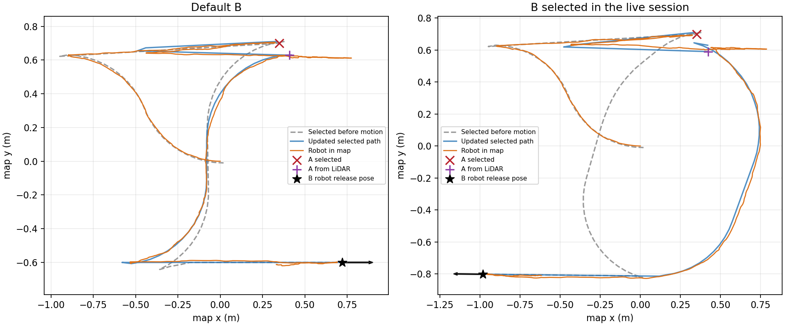
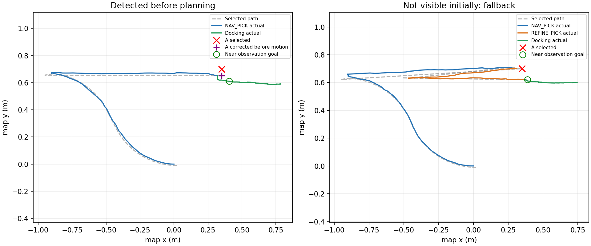
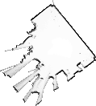

# Xe nâng AMR mecanum

Đồ án xe nâng tự hành dùng **ROS 2 Humble** và **Gazebo Fortress**, phát triển từ
[Trkkhrmn/ros2_amr_mecanumbot](https://github.com/Trkkhrmn/ros2_amr_mecanumbot).
Robot dùng bốn bánh, LiDAR, IMU và cơ cấu nâng vít me. Từ 30/10/2026 xe thật dùng
**bánh cao su V3 Ø85 mm** (lái skid-steer, không đi ngang) thay cho bánh mecanum
Ø100 mm; hai kiểu bánh chọn được khi launch, xem [Chọn kiểu bánh](#chọn-kiểu-bánh).

Người dùng đã xác nhận robot thật và mô phỏng tạo được map. Chu trình lấy–giao
tự động trong repo được kiểm chứng trong mô phỏng; **chưa nghiệm thu chu trình
này trên robot thật**. Có cả chế độ trạm cố định về Home và chế độ A/B chọn trên RViz.

## Chức năng hiện tại

- Mô hình CAD URDF20 được tích hợp trong `forklift_description`.
- Điều khiển bốn bánh (cao su skid-steer hoặc mecanum), nâng/hạ và homing càng trong mô phỏng.
- SLAM, định vị AMCL và điều hướng Nav2; EKF kết hợp odometry bánh với IMU mô phỏng.
- Bộ bám đường mặc định **MPPI**, cho phép tiến/lùi theo đường cong.
- Nhiệm vụ trạm cố định dùng Nav2 FollowPath theo các điểm đã duyệt.
- Nhiệm vụ A/B chọn trên RViz thử nhận dạng LiDAR ngay lúc Run, tạo tuyến tới A đã sửa theo các profile cũ và dùng FollowPath; kiểm tra lại trước khi căn chỉnh/chèn càng.
- Khi chạy Nav2 dùng vận tốc tiến/lùi và quay. Đi ngang chỉ có với bánh mecanum
  (teleop hoặc docking); bánh cao su docking bằng tiến/lùi + bẻ lái.

## Chọn bài chạy thử

Build và source workspace theo phần [cài đặt](#tải-mã-nguồn-và-build) trước khi chạy.
Mỗi dòng dưới đây là một chế độ riêng; dừng phiên cũ trước khi đổi chế độ.

| Bài thử | Lệnh chính | Kết quả cần quan sát |
|---|---|---|
| [SIM: lái tay và nâng/hạ](#chạy-thủ-công-trong-mô-phỏng) | `ros2 launch forklift_bringup sim.launch.py auto_home:=true` | Gazebo/RViz mở, càng homing, xe nhận phím |
| [SIM: tạo bản đồ](#slam-và-điều-hướng-riêng) | `ros2 launch forklift_bringup mapping.launch.py` | Bản đồ mở rộng khi lái xe bằng teleop |
| [SIM: điều hướng](#slam-và-điều-hướng-riêng) | `ros2 launch forklift_bringup navigation.launch.py` | Nav2 `READY`, xe tới Nav2 Goal trên RViz |
| [SIM: lấy–giao pallet](#chạy-nhiệm-vụ-lấygiao-hàng-tại-trạm-cố-định) | `ros2 launch forklift_bringup p6.launch.py wheel_type:=mecanum` | Hoàn tất lấy, nâng, giao và rút càng; cấu hình tái hiện kết quả đã lưu |
| [REAL: mapping](#mapping-robot-thật-pi--laptop) | Pi: `lidar.launch.py` + `real.launch.py`; laptop: `mapping_real.launch.py` | Có `/scan`, `/odom`, bản đồ và lưu được YAML/PGM |
| [REAL: chạy với map đã lưu](#điều-hướng-robot-thật-với-bản-đồ-đã-lưu) | Pi: LiDAR `/scan_raw` + `real.launch.py`; laptop: `navigation_real.launch.py map:=...` | Scan khớp map, định vị đúng, thử một goal ngắn |

Các tên launch trong hai dòng REAL đều thuộc package `forklift_bringup`.
Xe thật mặc định dùng bánh cao su; phần [ảnh kết quả](#ảnh-và-kết-quả-đã-lưu)
ghi rõ dữ liệu mô phỏng và bản đồ tham khảo.

## Chọn kiểu bánh

Mọi launch bringup nhận tham số `wheel_type`, mặc định `rubber`:

| `wheel_type` | Bánh | Động học | Đi ngang |
|---|---|---|---|
| `rubber` (mặc định) | Cao su V3 Ø85 mm, r = 0,0425 m | Skid-steer: hai bánh cùng bên cùng tốc độ | Không |
| `mecanum` | Mecanum Ø100 mm, r = 0,05 m | Mecanum (vx, vy, ωz) | Có |

```bash
ros2 launch forklift_bringup real.launch.py                      # bánh cao su
ros2 launch forklift_bringup real.launch.py wheel_type:=mecanum  # bánh mecanum cũ
ros2 launch forklift_bringup p6.launch.py wheel_type:=mecanum    # tái hiện kết quả SIM cũ
```

Tham số này đổi đồng thời:

- **URDF**: bán kính, hình và ma sát bánh; khung, LiDAR, IMU và càng hạ theo
  chênh lệch bán kính (bánh cao su thấp hơn 7,5 mm).
- **SIM**: `diff_drive_controller` cho bánh cao su, `mecanum_drive_controller` cho mecanum.
- **Xe thật**: hồ sơ trong `src/forklift_hardware/config/wheels_real.yaml` đè
  `wheel_radius`, `kinematic_sum`, `max_wheel_speed`, `drive_type` của `esp32.yaml`.
  Firmware ESP32 không đổi vì chỉ nhận tốc độ từng bánh.
- **Command gate**: bánh cao su bỏ mọi `vy` (log `STRAFE_IGNORED`).
- **Nav2**: AMCL `DifferentialMotionModel` và smoother khóa `vy = 0` với bánh cao su.

Với nhiệm vụ trên xe thật, truyền **cùng** `wheel_type` cho `real.launch.py` trên Pi
và `navigation_real.launch.py`/`mapping_real.launch.py` trên laptop.

Động học bánh cao su: bánh trái = (vx − k·ωz)/r, bánh phải = (vx + k·ωz)/r. Ở đây k là
nửa vết bánh hiệu dụng, gồm cả trượt ngang khi quay: k = ly·(1 + (lx/ly)²) ≈ 1,46·ly.
**Các số của bánh cao su là danh nghĩa, chưa hiệu chuẩn**: r = 0,0425 m,
k = 0,2265 m (xe thật), bề rộng 38 mm, khối lượng 0,12 kg. Cần chạy thẳng 1 m để
chỉnh `wheel_radius` và quay 360° để chỉnh `kinematic_sum` (quay thiếu thì tăng).
Trần bánh giữ 6 rad/s nên tốc độ thẳng tối đa còn **0,255 m/s** (mecanum: 0,30).
Kết quả SIM trước 30/10/2026 là của bánh mecanum; chưa chạy lại P6 SIM với bánh cao su.

Ở chế độ trạm cố định, đường nhiệm vụ được công bố đầy đủ trước khi xe di chuyển. Nếu tuyến không hợp lệ,
xe dừng/báo lỗi thay vì tự chọn tuyến khác. Giới hạn vận tốc nhiệm vụ hiện tại:
**tiến 0,25 m/s, lùi 0,16 m/s**; docking và chèn càng chạy chậm hơn.

## Môi trường cần có

- Ubuntu **22.04**, ROS 2 **Humble** đã được cài và cấu hình.
- Gazebo **Fortress**; executable là `ign gazebo`.
- `colcon`, `rosdep` và các dependency ROS trong `src/*/package.xml`.
- Các thành phần chính: `gz_ros2_control`, `ros_gz_bridge`, `ros_gz_sim`,
  `ros2_controllers`, Nav2/MPPI, SLAM Toolbox, `robot_localization` và RViz2.
- OpenGL/EGL hoạt động để mô phỏng GPU LiDAR, kể cả khi không mở Gazebo GUI.

Các package gốc `mecanum_*` được giữ để đối chiếu và có `COLCON_IGNORE`.
Giữ các file này khi build hệ thống Fortress; các package đang sử dụng mang tên `forklift_*`.

## Tải mã nguồn và build

Ví dụ đặt dự án tại `~/ros_ws/forklift`:

```bash
mkdir -p ~/ros_ws
cd ~/ros_ws
git clone https://github.com/thanhnt2410/forklift.git
cd forklift
source /opt/ros/humble/setup.bash
```

Nếu đã có workspace, vào thư mục dự án hiện tại, không cần clone lại.
Cài công cụ nếu máy chưa có:

```bash
sudo apt update
sudo apt install python3-colcon-common-extensions python3-rosdep
```

Khởi tạo `rosdep` một lần bằng `sudo rosdep init` nếu máy chưa được khởi tạo, sau đó:

```bash
rosdep update
rosdep install --from-paths src --ignore-src --rosdistro humble -r -y
colcon build --symlink-install
source install/setup.bash
```

ROS 2 Humble và Gazebo Fortress cần được cài trước bước này. Không dùng Gazebo
Classic thay cho Fortress. `dependencies.repos` chỉ lưu baseline upstream để tham khảo;
không import đè lên mã nguồn `src/` đã chỉnh sửa.

**Trong mỗi terminal mới**, nạp môi trường trước khi chạy lệnh ROS:

```bash
cd ~/ros_ws/forklift
source /opt/ros/humble/setup.bash
source install/setup.bash
```

## Chọn ô pallet trên RViz và lấy–giao nhiều chuyến

Sau khi build/source lại workspace, chạy
`ros2 launch forklift_bringup p6.launch.py wheel_type:=mecanum`
để dùng cấu hình đã có kết quả kiểm thử.
Trong RViz, dùng **Pick slot** (phím A) đặt các ô lấy hàng — đánh số 1, 2, 3 — và
**Drop slot** (phím B) đặt các ô đặt hàng — đánh số 4, 5, 6 — rồi bấm **Run mission**
trong panel **Pallet mission**. Xe chạy lần lượt ô 1 → ô 4, ô 2 → ô 5, ô 3 → ô 6;
mỗi chuyến chở một pallet, chuyến sau chỉ bắt đầu khi chuyến trước thành công.
**Save slots** / **Load slots** giữ lại danh sách ô cho lần chạy sau.
Robot dùng LiDAR sửa pose tiếp cận A, căn chỉnh/chèn càng, nâng, vận chuyển tới B,
hạ và lùi ra; nhiệm vụ kết thúc tại đó. B là vùng thả trống, độ chính xác vật lý
còn phụ thuộc AMCL. Đây là nhánh `pick_and_place`; lệnh `a_to_b` bên dưới giữ
chu trình trạm cố định và về Home.

Xem [hướng dẫn A/B, giới hạn nhận dạng và tích hợp robot thật](docs/dynamic_mission.md).
[Báo cáo kiểm thử A/B](results/final/dynamic_mission/README.md) ghi kết quả,
quỹ đạo và giới hạn sai số tại B.
[Bản sửa tạo path theo code cũ](results/final/path_pipeline_fix/README.md) ghi
chẩn đoán phiên Run bị lỗi và kết quả kiểm thử sau khi chuyển sang FollowPath.
[Nhận dạng ngay lúc Run](results/final/early_detection/README.md) ghi kết quả
nhánh lập tuyến sớm, fallback và xác nhận lại khi tới gần pallet.
Launch robot thật hiện có chế độ thử nâng xung preset và mặc định bỏ kiểm tra
cảm biến tải (`load_feedback:=none`), nên người vận hành phải quan sát tải.
Chiều cao nâng chưa hiệu chuẩn và chu trình thật chưa được nghiệm thu;
xem [cách chạy trên map thật](#điều-hướng-robot-thật-với-bản-đồ-đã-lưu).

## Chạy nhiệm vụ lấy–giao hàng tại trạm cố định

Terminal 1 — mở thế giới có pallet, Gazebo, RViz, Nav2 và bộ quản lý nhiệm vụ:

```bash
ros2 launch forklift_bringup p6.launch.py controller:=mppi wheel_type:=mecanum
```

Launch tự homing càng trong SIM. Chờ `/navigation/status` báo `READY` và
`/lift/state` có `homed: true`, không có lỗi. Có thể xem trong terminal đã source:

```bash
ros2 topic echo /navigation/status --once
ros2 topic echo /lift/state --once
```

Terminal 2 — gửi nhiệm vụ:

```bash
ros2 action send_goal /mission/run forklift_interfaces/action/RunMission '{mission: a_to_b, timeout: 300.0}' --feedback
```

Chu trình: **Home → tới A → căn chỉnh/chèn càng → nâng → vận chuyển tới B →
thả hàng → rút càng → về Home**. Theo dõi tiến trình bằng feedback của action,
RViz hoặc topic `/mission/status`.

Một số tùy chọn:

```bash
# Tắt hai cửa sổ, vẫn chạy mô phỏng và cần renderer cho LiDAR:
ros2 launch forklift_bringup p6.launch.py wheel_type:=mecanum gui:=false rviz:=false

# Dùng bộ RPP để đối chiếu thay cho MPPI:
ros2 launch forklift_bringup p6.launch.py wheel_type:=mecanum controller:=rpp
```

Chọn một lệnh launch cho mỗi phiên. Dừng phiên bằng **Ctrl+C tại terminal launch**
và chờ tiến trình thoát trước khi mở phiên mới. Không chạy đồng thời nhiều bringup
trong cùng ROS domain/Gazebo partition.

## Chạy thủ công trong mô phỏng

Dừng phiên nhiệm vụ trước khi chuyển sang chế độ này.

Terminal 1 — mở mô phỏng cơ bản và tự homing càng:

```bash
ros2 launch forklift_bringup sim.launch.py auto_home:=true
```

Terminal 2 — sau khi càng đã homing, chạy điều khiển bằng phím mũi tên:

```bash
ros2 run forklift_control arrow_teleop.py
```

Click vào terminal điều khiển để nhận phím:

| Phím | Chức năng |
|---|---|
| ↑ / ↓ | Tiến / lùi 0,30 m/s |
| ← / → | Quay trái / phải, 0,6 rad/s |
| A / D hoặc Shift + ← / → | Đi ngang trái / phải, 0,30 m/s (chỉ `wheel_type:=mecanum`) |
| R hoặc Page Up | Nâng càng thêm 1 cm |
| F hoặc Page Down | Hạ càng 1 cm |
| H hoặc Home | Homing càng |
| Space hoặc S | Dừng bánh và càng nâng |
| Q hoặc Ctrl+C | Dừng và thoát điều khiển |

Các phím chữ nhận cả chữ thường và chữ hoa (Shift/Caps Lock). Chọn bộ gõ tiếng Anh
để terminal gửi đúng phím A/D/R/F/H. Sau khi cập nhật code, thoát node bàn phím
cũ rồi chạy lại lệnh trên để nạp bản mới.

Giữ phím để lặp lệnh. Terminal không cung cấp sự kiện nhả phím: sau khoảng
0,35 s không nhận phím mới, node gửi zero qua command gate. Tốc độ dừng còn chịu
giới hạn gia tốc của gate. Lần giữ phím đầu có thể ngắt ngắn trước khi hệ điều hành
bắt đầu lặp phím; Space dùng để gửi dừng chủ động.
Không chạy cùng bàn phím khác, node tay cầm hoặc nhiệm vụ tự động.

Nhả phím di chuyển và chờ xe dừng trước khi bấm R/F/H. Lệnh nâng/hạ chạy tới
đích mỗi nấc 1 cm, không cần giữ phím; Space dừng giữa chừng. Khi đang nâng/home,
lệnh lái bị bỏ qua, không được xếp hàng để chạy lại sau đó. Cần homing trước
khi nâng/hạ; chiều cao được giới hạn 0–0,115 m trong SIM.

Có thể chọn thế giới kho bằng `world:=warehouse` khi launch mô phỏng.
Nếu không bật `auto_home`, gọi homing trước khi lái:

```bash
ros2 action send_goal /lift/home forklift_interfaces/action/HomeLift '{}' --feedback
```

Nâng 10 cm, hạ về mốc homing hoặc dừng nâng, mỗi lần chọn một lệnh:

```bash
ros2 action send_goal /lift/move forklift_interfaces/action/MoveLift '{height: 0.10}' --feedback
ros2 action send_goal /lift/move forklift_interfaces/action/MoveLift '{height: 0.0}' --feedback
ros2 service call /lift/stop std_srvs/srv/Trigger '{}'
```

Trong SIM, xe bị khóa khi chưa homing, đang nâng/hạ hoặc trạng thái càng không cho
phép di chuyển. Gửi vận tốc teleop vào `/cmd_vel_teleop`; `/cmd_vel` là đầu ra nội bộ.

## Tay cầm PS4 trong mô phỏng

Đây là cấu hình SDL chuẩn để dùng khi có tay cầm; hiện có thể dùng phím mũi tên
như trên. Tay cầm USB 2,4 GHz chưa rõ model cần enumerate và kiểm tra ánh xạ trước.

Cài `ros-humble-joy`, build lại workspace và kết nối tay cầm PS4 qua USB hoặc
Bluetooth. Chạy mô phỏng thủ công như trên, rồi ở terminal đã source khác:

```bash
ros2 launch forklift_bringup ps4.launch.py
```

Thả L1 và đưa cần về giữa, sau đó giữ L1 để chạy: cần trái tiến/lùi/đi ngang (đi ngang chỉ với mecanum),
cần phải xoay. L1 + D-pad lên/xuống nâng/hạ từng 1 cm; L1 + Triangle homing;
Circle gửi dừng bánh và nâng. Nhả L1 hoặc mất Joy sẽ gửi zero trong SIM.
Không chạy đồng thời với bàn phím hoặc nhiệm vụ tự động.

Xem [kết nối, ánh xạ nút và giới hạn PS4](docs/ps4_teleop.md).
Đã có tích hợp phần mềm; chưa kiểm chứng bằng tay cầm thật trong phiên này.

## SLAM và điều hướng riêng

Các chế độ dưới đây đã bao gồm Gazebo và RViz. Chạy từng chế độ riêng, không mở
chồng với `p6.launch.py` hoặc `sim.launch.py`:

```bash
# Lập bản đồ bằng LiDAR; dùng teleop để di chuyển:
ros2 launch forklift_bringup mapping.launch.py

# Terminal khác: lái xe để quét map (đã source ROS/workspace):
ros2 run forklift_control arrow_teleop.py

# Định vị và điều hướng trên bản đồ kho đã có, mặc định MPPI:
ros2 launch forklift_bringup navigation.launch.py
```

Trong chế độ navigation, chờ trạng thái `READY` rồi dùng **Nav2 Goal** trên RViz.
Nếu pose ban đầu sai, đặt lại bằng **2D Pose Estimate**. Bản đồ mặc định ở
`src/forklift_navigation/maps/warehouse.yaml`; dùng bản đồ khác bằng tham số `map`:

```bash
ros2 launch forklift_bringup navigation.launch.py map:=/duong/dan/toi/map.yaml
```

Để lưu map mô phỏng, dừng xe, giữ phiên mapping chạy và mở terminal khác:

```bash
mkdir -p ~/maps
ros2 service call /slam_toolbox/save_map slam_toolbox/srv/SaveMap \
  "{name: {data: '$HOME/maps/forklift_sim'}}"
```

Sau đó tắt mapping trước khi mở navigation với
`map:=$HOME/maps/forklift_sim.yaml`. Dùng cùng `wheel_type` khi tạo và chạy map;
nếu teleop đã chuyển command gate sang manual, thoát teleop rồi bật lại autonomous
bằng service như ở phần [điều hướng thật](#điều-hướng-robot-thật-với-bản-đồ-đã-lưu).

## Phần cứng và firmware ESP32

Phần cứng dự kiến: ESP32 DevKit WROOM 38 chân, bốn GA25-370 có encoder A/B,
bốn BTS7960, TB6600/NEMA17 cho nâng và MPU6050 dự kiến nối Raspberry Pi.

Đã có khung firmware đọc encoder, PID bánh, Serial CSV và điều khiển nâng. Tuy nhiên,
PI hiện tại **Kp=0,1; Ki=0,5; Kd=0** được đặt cho cả bốn bánh, kèm feedforward.
**Firmware hiện bật profile thử bánh**, trần PWM 100%, giới hạn MCU 10 rad/s,
giới hạn phía ROS 6 rad/s (tịnh tiến 0,255 m/s với bánh cao su r = 0,0425 m;
0,30 m/s với mecanum r = 0,05 m), và boot
disarm; nâng dùng **một công tắc NC dưới GPIO15**, R nâng thêm 20.000 xung,
F/H hạ tối đa 30 giây hoặc dừng sớm tại công tắc. Không cần home trước khi nâng/lái;
quãng nâng thực tế sẽ đo và hiệu chỉnh sau. Mức điện, chân boot,
chiều motor/encoder và PI cần kiểm tra theo xe, mặt sàn và tải thực tế. Đã bổ sung backend USB/UART CSV đơn giản và
`real.launch.py` để dùng cùng bàn phím với ESP32, đọc encoder và điều khiển nâng.
Serial mặc định 115200 baud, CSV từng dòng không CRC/boot ID/ACK; ESP32 tự phát
trạng thái 20 Hz. Cần cập nhật firmware và ROS cùng phiên bản giao thức.
Các tham số thử nằm ở `firmware/esp32/forklift_esp32/board_config.h`.

Bánh không quay ở tốc độ thấp dù PWM cao, hoặc encoder ngược chiều lệnh kéo
dài trên 0,5 s, hiện chỉ phát `WHEEL_TRACKING_WARNING` theo từng bánh; không
khóa MCU hoặc tự disarm. Warning tự hết khi điều kiện hết hoặc nhận lệnh dừng.
Phải **nạp lại firmware chính và cập nhật/build bridge trên Pi** để áp dụng.
Các trường hợp encoder nhảy số phi lý hoặc bánh còn chạy khi nâng vẫn là lỗi 8
(bánh lăn thật hơn 20 xung hoặc > 0,15 rad/s liên tục 0,2 s; rung ±1 xung không tính).
Đổi sang warning không tự khắc phục thiếu mô-men ở tốc độ thấp; xem
[chi tiết cảnh báo encoder](docs/esp32_manual_control.md#cảnh-báo-bánh-không-quay-ở-tốc-độ-thấp).

Sau khi firmware đã được cấu hình đúng và nạp riêng, mở kết nối bằng:

```bash
ros2 launch forklift_bringup real.launch.py
```

Launch mặc định lấy `port` từ `esp32.yaml`, dùng đường dẫn `by-path` ổ USB
`1.3` trên Pi; LiDAR dùng ổ `1.4`. Giữ đúng hai ổ cắm này dù số `ttyUSB0/1`
thay đổi. Có thể ghi đè bằng `port:=/dev/serial/by-path/...`.
Chế độ dò telemetry chỉ dùng khi truyền `port:=auto`, cần `fuser` từ gói `psmisc`.
Launch mặc định `auto_arm:=true`: tự arm một lần sau khi có telemetry hợp lệ,
bánh đứng yên và lệnh zero mới từ command gate; không cần gọi service arm.
Dùng `auto_arm:=false` nếu muốn arm thủ công. Launch còn mặc định `auto_home:=true`
(hạ càng lúc khởi động), `imu:=true` (MPU + EKF) và `autonomous:=true`.
Chuẩn bị khoảng trống cho càng trước khi launch. Xem
[hướng dẫn ESP32: cấu hình, bàn phím và reset](docs/esp32_manual_control.md).
LiDAR trên Pi chạy riêng bằng `ros2 launch forklift_bringup lidar.launch.py`,
dùng cấu hình `src/forklift_hardware/config/ydlidar.yaml`.
Xem [hướng dẫn LiDAR Pi và kết nối laptop](docs/ydlidar_pi.md).
Kết quả kiểm thử bridge bằng PTY nằm trong repo; người dùng đã xác nhận mapping
trên xe thật, còn chu trình lấy–giao thật chưa được nghiệm thu.

Theo lựa chọn phần cứng hiện tại, R_EN/L_EN kéo HIGH ngoài. Bridge mặc định
`stop_on_fault=true`, gửi D khi phát sinh lỗi nếu serial còn hoạt động.
Firmware chưa có watchdog Serial: nếu USB mất hoặc MCU không nhận được D,
bánh có thể giữ lệnh/PWM cuối, cần ngắt nguồn động lực thủ công.
Cơ cấu nâng giữ homing/giới hạn và dừng khi lỗi.
Đây là cấu hình firmware phần cứng, **không thay đổi cơ chế dừng của mô phỏng ROS**.

Xem [hướng dẫn firmware và GPIO](firmware/esp32/README.md),
[cấu hình ESP32/PID](firmware/esp32/forklift_esp32/board_config.h) và
[thông số phần cứng](config/robot_measurements.yaml).

## Mapping robot thật: Pi + laptop

Hướng dẫn này dùng khi **ESP32 và LiDAR cắm USB vào Pi**. Pi chạy driver phần
cứng; laptop chạy SLAM, RViz và bàn phím điều khiển. Hai máy cần cùng mạng,
cùng `ROS_DOMAIN_ID`, đã cập nhật và build code tương ứng. Các đường dẫn dưới
đây giả sử repo nằm tại `~/ros_ws/forklift` trên Pi và `~/workspace/forklift`
trên laptop; thay theo thư mục thực tế nếu khác.

### 1. Trên Pi: chạy LiDAR trước, ESP32 sau

Trong **mỗi terminal trên Pi**, chạy phần thiết lập:

```bash
source /opt/ros/humble/setup.bash
source ~/ros_ws/forklift/install/local_setup.bash
export ROS_DOMAIN_ID=0
export ROS_LOCALHOST_ONLY=0
```

Terminal 1 — chạy LiDAR theo ổ USB `by-path` đã cấu hình:

```bash
ros2 launch forklift_bringup lidar.launch.py
```

Terminal 2 — chạy ESP32 ở ổ USB `1.3` đã cấu hình:

```bash
ros2 launch forklift_bringup real.launch.py
```

Mặc định không dò cổng: ESP32 dùng `by-path` ổ `1.3`, LiDAR dùng ổ `1.4`.
Nếu đổi ổ, cập nhật `port` trong YAML tương ứng. Nếu LiDAR dùng file riêng,
truyền cùng file đó qua `lidar_params_file:=...` cho `real.launch.py` để bridge
kiểm tra tránh mở nhầm cổng LiDAR.

`real.launch.py` không tự chạy LiDAR. ESP32 cắm vào Pi thì bridge phải chạy trên
Pi, kể cả khi mở terminal qua SSH từ laptop. Đóng bridge cũ và Serial Monitor
trước khi chạy. Bridge hiện thử mở lại cổng sau 3 giây không nhận dữ liệu;
kiểm tra `/esp32/status` sau khi rút/cắm lại USB và khởi động lại launch nếu
kết nối không phục hồi.

### 2. Trên laptop: chạy SLAM và RViz

Trong **mỗi terminal trên laptop**, chạy phần thiết lập:

```bash
source /opt/ros/humble/setup.bash
source ~/workspace/forklift/install/local_setup.bash
export ROS_DOMAIN_ID=0
export ROS_LOCALHOST_ONLY=0
```

Terminal 1 — kiểm tra dữ liệu từ Pi rồi chạy mapping:

```bash
ros2 topic echo /esp32/status --once
ros2 topic echo /scan --once --field header
ros2 topic echo /odom --once --field header
ros2 launch forklift_bringup mapping_real.launch.py
```

Launch mở RViz với Fixed Frame `map`, phát TF robot từ URDF CAD và chạy SLAM
Toolbox bằng thời gian thực. TF LiDAR lấy từ URDF theo `wheel_type`; launch thật
đặt yaw LiDAR **+90°**, cùng cấu hình với navigation thật. Không chạy thêm static TF test cho
`base_link -> laser_frame` hoặc một `robot_state_publisher` khác.

Mỗi lần khởi động `mapping_real.launch.py` là **phiên tạo bản đồ mới**. Chạy một
phiên tại một thời điểm. `mapping.launch.py` là launch mô phỏng Gazebo.

Mapping hiện xuất thêm `/map_probability` với xác suất ô `0–100` và
`/mapping/trajectory` với các pose SLAM đã hiệu chỉnh. RViz mapping hiển thị
bản đồ nhiều mức xám và đường màu cam. `/map` vẫn phục vụ bản đồ điều hướng.
Launch thật lọc dữ liệu LiDAR trước SLAM và báo tình trạng tại
`/mapping/scan_status`. Xem [cách build, ghi bag, kiểm chứng và lưu bản đồ xác suất](docs/probability_mapping.md).

Panel **SLAM Toolbox** được mở sẵn trong RViz mapping. Nút **Save Map** lưu
đồng thời bản đồ điều hướng, bản đồ xác suất PNG/YAML và JSON giữ giá trị ô
nguyên gốc, với cùng prefix do bạn nhập.

Mapping dùng `lifecycle_manager_mapping` cho saver; AMCL và các server Nav2
được quản lý bởi hai lifecycle manager riêng. Xem [trạng thái và lệnh lifecycle](docs/lifecycle.md).

### 3. Điều khiển quét bản đồ

Terminal 2 trên laptop — khi sẵn sàng cho xe chạy:

```bash
ros2 topic echo /esp32/status --once
```

Chờ trạng thái `ARMED; host=OK; mcu=ACTIVE; fault=0` trước khi mở bàn phím.
Bridge mặc định tự arm; không cần chạy service. Sau khi arm vẫn cần lệnh zero
mới trước khi nhận lệnh di chuyển, nên thả phím rồi bấm lại nếu đã giữ từ trước.

```bash
ros2 run forklift_control arrow_teleop.py
```

Focus terminal bàn phím, chờ `Manual mode ready`. Dùng phím mũi tên để tiến/lùi
và quay (A/D đi ngang chỉ khi `wheel_type:=mecanum`); Space/S để dừng. Điều khiển xe chậm qua khu vực cần
quét rồi quay về vùng đã đi qua. Trong RViz, tường nên đứng yên và các lượt quét
chồng khớp; nếu tường bị đôi hoặc xoay theo xe, dừng để kiểm tra TF, odom và
timestamp trước khi quét tiếp.

### 4. Lưu bản đồ

Dừng xe và giữ SLAM chạy. Trong terminal khác trên laptop đã source workspace:

```bash
mkdir -p ~/maps
ros2 service call /slam_toolbox/save_map slam_toolbox/srv/SaveMap \
  "{name: {data: '$HOME/maps/forklift_real'}}"
```

Lệnh (hoặc nút Save Map trong RViz) lưu `forklift_real.yaml/.pgm`, bản đồ xác suất
`forklift_real_probability.yaml/.png` và `forklift_real_probability.grid.json`
trong `~/maps`. Đổi prefix để giữ bản đồ cũ. Muốn tiếp tục phiên SLAM sau
khi tắt cần lưu thêm pose graph. Xem [hướng dẫn LiDAR và mapping thật](docs/ydlidar_pi.md).

Sau khi lưu và dừng xe, disarm trước khi kết thúc các launch:

```bash
ros2 service call /esp32/arm std_srvs/srv/SetBool '{data: false}'
```

Disarm thủ công sẽ hủy auto arm trong phiên hiện tại. Cấu hình hiện bật
`auto_rearm` cho lỗi timeout telemetry/lệnh sau khi dữ liệu phục hồi và bánh
đứng yên; lỗi MCU/E-stop vẫn cần xử lý riêng. Sau khi chủ động disarm, chỉ arm
lại khi đã sẵn sàng bằng service hoặc một phiên launch mới.

## Điều hướng robot thật với bản đồ đã lưu

Dùng cùng môi trường ROS/mạng như phần mapping trên **mọi terminal** của Pi và
laptop. Ví dụ dùng `ROS_DOMAIN_ID=0`; nếu hệ thống đang dùng domain 1 thì đổi
đồng loạt hai máy sang 1. Nếu dùng Cyclone DDS, cài `ros-humble-rmw-cyclonedds-cpp`
và đặt `export RMW_IMPLEMENTATION=rmw_cyclonedds_cpp` trên cả hai máy.

### 1. Pi: driver và bridge phần cứng

Dừng phiên SLAM `mapping_real.launch.py` trên laptop và phiên LiDAR cũ trên Pi.
AMCL sẽ phát `map → odom` thay SLAM; không chạy hai nguồn TF này cùng lúc.

Terminal 1 trên Pi — LiDAR phải xuất **`/scan_raw`**:

```bash
ros2 launch forklift_bringup lidar.launch.py scan_topic:=/scan_raw
```

Terminal 2 trên Pi — nếu bridge đã chạy đúng cấu hình thì giữ phiên đó:

```bash
ros2 launch forklift_bringup real.launch.py wheel_type:=rubber imu:=true
```

`real.launch.py` chạy bridge, command gate, MPU và EKF; không tự mở LiDAR.
`navigation_real.launch.py` trên laptop nhận `/scan_raw` rồi relay ra `/scan`
cho Nav2. Chạy LiDAR thẳng ra `/scan` trong chế độ này sẽ thiếu đầu vào thô.

### 2. Laptop: nạp map và kiểm tra định vị

Map YAML và ảnh được YAML tham chiếu phải cùng có trên **laptop**. Ví dụ dùng
map vừa lưu trong `~/maps`:

```bash
ros2 topic echo /esp32/status --once
ros2 topic echo /scan_raw --once --field header
ros2 topic echo /odom --once --field header
ros2 launch forklift_bringup navigation_real.launch.py \
  map:=$HOME/maps/forklift_real.yaml wheel_type:=rubber use_ekf:=true
```

Nếu dùng map có sẵn trong repo, thay `map` bằng đường dẫn tuyệt đối tới
`src/mecanum_navigation/maps/home1.yaml` trong checkout trên laptop. Map đó chỉ
phù hợp khu vực đã quét; hãy dùng map của nơi đang thử xe.

Giữ `wheel_type` giống nhau trên hai máy. Nếu Pi chạy `imu:=false`, laptop phải
chạy `use_ekf:=false`. Không khởi chạy thêm EKF trên laptop.

Launch mặc định `auto_localize:=true` để thử tìm pose ban đầu từ LiDAR. Trong
RViz, kiểm tra scan trùng tường trên map và hướng robot đúng. Nếu chưa khớp,
dùng **2D Pose Estimate** đặt lại pose; có thể thêm `auto_localize:=false` khi
muốn tự đặt ngay từ đầu. Khi xe đứng yên, yêu cầu AMCL cập nhật thêm bằng:

```bash
ros2 service call /request_nomotion_update std_srvs/srv/Empty '{}'
ros2 topic echo /navigation/status --once
```

### 3. Thử goal ngắn rồi mới thử lấy–giao

Chờ navigation `READY`, ESP32 `ARMED`, `fault=0` và pose khớp map. Nếu trước đó
đã mở `arrow_teleop.py`, dừng xe, thoát node bàn phím rồi bật lại chế độ tự động:

```bash
ros2 service call /command_gate/set_autonomous std_srvs/srv/SetBool '{data: true}'
```

Dùng **Nav2 Goal** chọn một điểm gần trong vùng trống và quan sát xe đi, quay,
dừng. Không mở bàn phím/PS4 trong lúc chạy tự động vì teleop có ưu tiên.

Để thử pallet, panel **Pallet mission** cho phép chọn các ô lấy/giao rồi bấm
**Run mission**. Trên REAL mặc định `pick_pose_mode:=pallet`: đặt ô lấy lên mặt
pallet, LiDAR tính điểm tiếp cận; SIM mặc định chọn pose đứng trước pallet.
Mặc định `pick_via_x:=true` cho xe tới điểm tiếp cận rồi mới đo pallet.

Đây là chế độ thử nghiệm có giám sát: `load_feedback:=none` bỏ xác nhận tải tự
động, và `carry_joint_position:=0.1` là mã nâng **20.000 xung**, chưa phải chiều
cao 10 cm đã đo. Khi có cảm biến tải thật, dùng `load_feedback:=external` với
topic `/pallet/load_detected`. Các kết quả SIM bên dưới chưa xác nhận độ chính
xác lấy–giao của xe thật.

Dừng nhiệm vụ bằng **Stop mission** trên panel; khi kết thúc thử, dừng xe,
disarm trước khi tắt các launch:

```bash
ros2 service call /esp32/arm std_srvs/srv/SetBool '{data: false}'
```

## Ảnh và kết quả đã lưu

Các ảnh dưới đây lấy từ dữ liệu sẵn trong repo. Đây là kết quả đã lưu,
không phải một lượt chạy SIM/REAL mới khi cập nhật README.

### SIM: đường lập kế hoạch và quỹ đạo thực hiện



Xám đứt: đường công bố trước chuyển động; xanh: đường cập nhật; cam: quỹ đạo
robot trong hệ `map`. Hai hình so sánh B mặc định và B do người dùng chọn.
Ảnh thuộc thử nghiệm **bánh mecanum**, trước khi chuyển sang bánh cao su.
Xem [báo cáo path và sai số tại B](results/final/path_pipeline_fix/README.md).

### SIM: nhận dạng pallet và hiệu chỉnh tiếp cận



Trái: nhận dạng trước khi đi, dùng A đã hiệu chỉnh. Phải: chưa thấy pallet ban
đầu, tới A sơ bộ rồi chạy `REFINE_PICK`. Báo cáo đã lưu ghi **16/16 ca,
373/373 phép kiểm tra đạt**, gồm cả ca hủy/lỗi dừng đúng dự kiến; không phải
16 nhiệm vụ lấy–giao thành công. Xem [báo cáo nhận dạng](results/final/early_detection/README.md)
và [số liệu gốc](results/final/early_detection/summary.json). Bộ kết quả này
chưa được chạy lại với bánh cao su mặc định hiện tại.

### REAL: bản đồ xác suất tham khảo



Ảnh `home1_probability.png` là bản đồ nhiều mức xám đi kèm bộ map `home1`
được dùng trong [ghi chú lệnh chạy thật](command_cmd.md), độ phân giải **0,04 m/ô**.
Để chạy Nav2, dùng [home1.yaml](src/mecanum_navigation/maps/home1.yaml) hoặc map
REAL tự lưu, thay vì lấy ảnh PNG làm đường dẫn `map`. Ảnh này minh họa bản đồ,
chưa phải bằng chứng nghiệm thu chu trình lấy–giao trên xe thật.

## Cấu trúc và cấu hình chính

| Đường dẫn | Nội dung |
|---|---|
| `src/forklift_bringup/` | Launch và cấu hình hiển thị RViz |
| `src/forklift_description/` | URDF, CAD, mesh và hình học xe |
| `src/forklift_control/` | Cấu hình controller bánh (mecanum/diff drive), command gate và EKF |
| `src/forklift_gazebo/` | World và bridge ROS–Gazebo |
| `src/forklift_navigation/` | SLAM, AMCL, Nav2, MPPI và bản đồ |
| `src/forklift_lift/`, `src/forklift_interfaces/` | Giám sát nâng, message và action |
| `src/forklift_task_manager/` | Tuyến đã duyệt, docking và nhiệm vụ |
| `src/forklift_hardware/` | Backend PTY/MCU giả và cầu nối ESP32 USB/UART CSV |
| `firmware/esp32/` | Mã firmware ESP32 đang phát triển |
| `docs/` | Tài liệu thiết kế và hướng dẫn chi tiết |
| `results/final/` | Nơi lưu kết quả cuối được chọn để đưa lên Git |

Các file thường cần chỉnh:

- [Hình học CAD dùng trong SIM](src/forklift_description/config/robot.yaml).
- [Cấu hình MPPI](src/forklift_navigation/config/nav2_mppi.yaml).
- [Các điểm path đã duyệt](src/forklift_task_manager/config/approved_route.json).
- [Trạm và docking](src/forklift_task_manager/config/stations.yaml).
- [Cấu hình nâng SIM](src/forklift_lift/config/lift.yaml).

Thư mục test và các kết quả ngoài `results/final/` chỉ giữ trên máy phát triển,
không có trong bản clone Git. README này không yêu cầu các file đó để chạy mô phỏng.

## Khi gặp vấn đề

- **Không tìm thấy package:** source lại ROS/workspace, kiểm tra dependency và build.
- **Xe không chạy:** kiểm tra homing càng, `/lift/state` và `/navigation/status`.
- **Mô phỏng chậm hoặc trùng xe:** dừng các phiên launch cũ trước khi mở phiên mới.
- **Không có LiDAR khi tắt GUI:** kiểm tra renderer OpenGL/EGL; tắt GUI không bỏ nhu cầu GPU.

Thiết kế và tiến độ chi tiết ở [PLAN.md](PLAN.md),
[điều hướng theo tuyến](docs/curved_navigation.md) và
[tích hợp CAD](docs/forklift_model.md).
Nguồn kế thừa và giấy phép được ghi tại [THIRD_PARTY_NOTICES.md](THIRD_PARTY_NOTICES.md).
