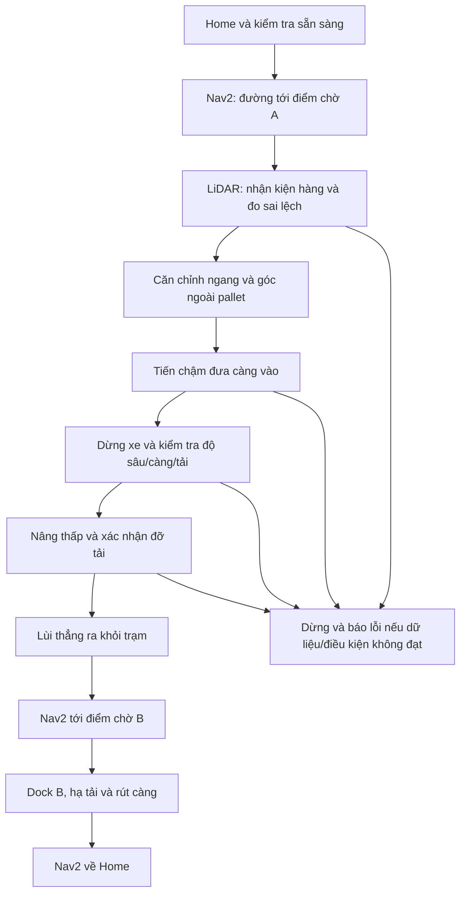

# Kế hoạch P6-SIM: tiếp cận, đưa càng vào và nâng pallet

Ngày: 23/10/2026. Trạng thái: **thiết kế ban đầu trước triển khai**, giữ làm cơ sở đối chiếu. P6-SIM đã có runtime; kích thước và cơ chế thực thi hiện tại xem [hướng dẫn P6](p6_simulation.md), kết quả cuối cập nhật trong PLAN.md.

Phạm vi: một pallet tại trạm lấy A có vị trí và hướng quy định; giao tại B, rồi về Home. Theo cập nhật của người dùng, kiện hàng được thiết kế đủ cao để LiDAR quét trực tiếp; thay phương án gá LiDAR rời bằng hình học kiện hàng có quan hệ cố định với pallet. Không mở rộng sang ESP32/xe thật hoặc tự tìm vật nằm tùy ý trong kho. Mô hình pallet/trạm là thiết kế SIM mới, chưa phải kích thước pallet thật đã được người dùng cung cấp.

## 1. Xe sẽ lấy hàng như thế nào?

1. Home càng, kiểm tra cảm biến/định vị và trạng thái điều khiển.
2. Nav2 lập đường tới **điểm chờ trước pallet**, đầu xe hướng vào miệng pallet; chưa đưa càng vào bằng Nav2.
3. Bộ docking nhận mặt/biên kiện hàng từ `/scan`, đo khoảng cách, lệch ngang và lệch góc tương đối; dùng khả năng đi ngang của mecanum để căn chỉnh ngoài pallet.
4. Dừng chỉnh ngang/quay khi đã vào khe; tiến thẳng chậm một đoạn được giới hạn, theo dõi độ lệch và điều kiện va chạm.
5. Dừng xe hoàn toàn; xác nhận càng đã vào đủ và có pallet hợp lệ, rồi nâng vài mm để nhấc pallet khỏi chân đỡ.
6. Xác nhận tải được đỡ trên càng; đặt mức vận chuyển thấp, lùi thẳng ra khỏi trạm trước khi quay/chạy Nav2 tới B.
7. Docking tại B, hạ pallet xuống nền/giá đỡ, xác nhận nhả tải, rút càng rồi về Home.

Đây là **lập đường toàn cục + điều khiển docking cục bộ + lập chuyển động nâng**, không phải một Nav2 goal ngay bên dưới vật.



## 2. Planning tới vị trí lấy hàng

Mỗi trạm có frame riêng: trục `x` theo chiều xe tiến vào, `y` ngang trạm. YAML chứa pose trạm trong `map` và biến đổi giữa mặt kiện hàng, miệng pallet, khe càng và mặt đỡ. Không lấy tọa độ vật từ Gazebo làm đầu vào điều khiển.

| Pose | Mục đích | Cách tới |
|---|---|---|
| `approach` | Điểm chờ, đầu càng còn cách miệng pallet khoảng 0,3–0,5 m; cần kiểm tra swept footprint | Nav2/global planner và DWB hiện có |
| `preinsert` | Căn tâm/hướng, đầu càng còn ngoài miệng pallet khoảng 3–5 cm | Docking controller theo mặt/biên kiện hàng |
| `inserted` | Càng vào đủ chiều sâu thiết kế, thân/mast vẫn cách pallet | Tiến thẳng chậm, quan sát mặt kiện và đoạn tiến giới hạn bằng odom/EKF |
| `retreated` | Càng và tải đã ra khỏi vùng trạm; đủ khoảng trống để điều hướng | Lùi thẳng có giới hạn, kiểm tra vùng phía sau |

Biến đổi mục tiêu: `T_map_base_goal = T_map_station × T_station_base_goal`. Khoảng cách tính từ **đầu càng**, không nhầm với gốc `base_link`. Theo URDF hiện tại, đầu càng xấp xỉ `x = 0.177 + 0.20 = 0.377 m` phía trước gốc xe.

Nav2 dùng map/AMCL và `/odom` từ EKF để tới `approach`, tránh vật cản như P4. Hết action thành công chỉ chuyển sang nhận kiện hàng, chưa đủ điều kiện nâng. Giới hạn sai số Nav2 15 cm là tiêu chí tới đích hiện có, không phải dung sai đưa càng vào khe.

Không đưa pose `inserted` vào Nav2 nếu footprint sẽ giao với pallet: Nav2 có thể từ chối đúng vì coi pallet là vật cản. Docking phải kiểm tra hình học 3D khe và các phần cấm va chạm, thay vì xóa pallet khỏi costmap hoặc tắt bảo vệ chung để ép xe đi vào.

## 3. Căn chỉnh trực tiếp theo kiện hàng đủ cao cho LiDAR

**Phương án chính đã điều chỉnh theo người dùng: pallet thấp + kiện hàng cao có hình dạng biết trước.** Kiện hàng đặt chắc chắn, đúng tâm/hướng trên pallet; mặt quét và khe càng có biến đổi hình học cố định. Không cần gá định vị LiDAR rời cho bản SIM đầu.

- LiDAR hiện đặt tại `z = 0.235 m` so với `base_link`, 360 tia/vòng, 10 Hz, độ phân giải range cấu hình 0,01 m. Thiết kế mặt trên kiện ở khoảng 0,28–0,30 m so với nền; hàng không nâng vẫn cắt mặt phẳng quét. Mặt dưới deck khoảng 0,05 m và khối hàng cao khoảng 0,22–0,24 m tùy bề dày deck. Chốt các kích thước bằng cùng một YAML, không cộng nhầm chiều cao pallet và kiện.
- Nhận mặt phẳng đứng phía trước kiện bằng fit đường trên scan 2D; dùng hai biên và bề rộng đã biết để tìm tâm. Chỉ fit một đoạn mặt phẳng chưa đủ xác định tâm ngang nếu không thấy biên; trường hợp thiếu biên/không đủ điểm phải báo không đủ quan sát thay vì tự suy tâm.
- AMCL chọn vùng tìm kiếm gần A/B; nhận dạng kiểm tra bề rộng, hướng, vị trí tương đối, số điểm, sai số fit, tuổi scan và tính liên tục. Hình học biết trước giúp phân biệt với kệ, nhưng chưa phải nhận dạng vật bất kỳ.
- Ước lượng `e_x`, `e_y`, `e_yaw` theo kiện/pallet. Ngoài pallet: chỉnh hướng và đi ngang bằng `vy`, rồi tiến tới `preinsert`. Khi càng vào khe: khóa chỉnh ngang/quay chủ động; vượt ngưỡng phải dừng.
- Mục tiêu thử ban đầu: lệch ngang ≤8 mm và góc ≤2°, ổn định khoảng 0,5 s trước khi tiến vào. Đây là mục tiêu cần đo, chưa chứng minh LiDAR hiện tại đạt được. Tốc độ docking khởi đầu ≤0,02 m/s, quay ≤0,08 rad/s; đưa càng vào ≤0,01 m/s.
- **Vùng che phải kiểm chứng:** LiDAR hiện ở `x=-0.035 m`, phía sau mast tại `x≈0.15 m`; mast rộng khoảng 0,09 m và đi qua mặt phẳng quét. Kiện cao chỉ giải quyết chiều cao, chưa giải quyết việc mast che mặt hàng. P6.1 phải thử scan tại toàn bộ các pose tiếp cận. Nếu cần, thiết kế lại vị trí LiDAR trong SIM để nhìn phía trước mast, cập nhật TF và kiểm chứng lại SLAM/Nav2; không âm thầm bỏ collision mast hoặc dùng pose Gazebo thay scan.
- **Khoảng cách gần:** range tối thiểu hiện 0,12 m. Không giả định scan còn thấy mặt hàng khi càng đã chui sâu. Xác định điểm chuyển từ bám mặt hàng sang tiến thẳng giới hạn bằng odom/EKF, dựa trên quan sát hợp lệ cuối cùng, sai số tích lũy, chiều sâu và contact. Nếu sai số đoạn không quan sát vượt khoảng hở thì phải đổi vị trí cảm biến/hình học hoặc dừng, không chạy mù không giới hạn.
- Kiện hàng nay là vật cản LiDAR thấy được: costmap/footprint không được xóa hàng tùy tiện để cho xe chui vào. Cần kiểm tra khe ở tầng docking, vùng cấm của chân/deck/kiện và cơ chế kiểm tra va chạm phù hợp. Khi đã mang tải, chỉ lọc điểm tự phản xạ của tải trong vùng hình học xác định, đồng thời mở rộng footprint gồm tải; không tắt obstacle layer.

Vì quan sát kiện hàng, xe có thể đo độ lệch kiện trong vùng tìm kiếm; tuy nhiên chỉ suy ra khe càng nếu kiện và pallet gắn đúng hình học thiết kế. Hàng lệch trên pallet hoặc thiếu pallet là lỗi, không suy từ thấy hộp thành có khe hợp lệ. Nếu detector không đạt mục tiêu, ghi đúng giới hạn và dừng nghiệm thu docking tự động; không tạo pose lý tưởng từ Gazebo để thay detector.

## 4. Thiết kế pallet và độ cao lấy hàng

Mô hình hiện tại: càng dài 200 mm, rộng 25 mm mỗi càng, tâm hai càng cách 140 mm; chiều dày 12 mm. Mặt trên càng theo URDF nằm khoảng:

```text
z_fork_top = z_base + 0.055 - 0.019 + 0.012/2 + q_lift
           = z_base + 0.042 + q_lift
q_lift = home_offset + height_action
```

`height_action` là chiều cao tương đối sau homing; `q_lift` là vị trí joint thô. `z_base` phải xét khi kiểm tra khe thật trong mô phỏng, không giả định luôn chính xác bằng không.

Thiết kế SIM ban đầu để kiểm tra hình học:

| Thông số | Giá trị dự kiến, chưa chốt bằng thử |
|---|---|
| Kiện hàng phía trên | Mặt trên khoảng 280–300 mm so với nền; bề rộng ban đầu theo pallet khoảng 240 mm, phải kiểm tra nhìn thấy đủ hai biên |
| Pallet mẫu | Sâu khoảng 160 mm, rộng khoảng 240 mm; có hai khe mở phía trước |
| Tâm khe | `y = ±70 mm`, khớp tâm càng |
| Bề rộng khe | Khoảng 70 mm/khe; chân/đà không nằm trên đường càng |
| Mặt dưới deck | Khoảng 50 mm trên nền trạm, để càng thấp có thể chui vào |
| Độ sâu đưa càng | Khoảng 140–150 mm; kiểm tra đỡ tâm tải và khoảng hở mast |
| Mức vận chuyển | Thử `q_lift ≈ 0.016 m`; sau hiệu chỉnh phải có biên so với gate 0,020 m |

Kiểm tra dung sai tối thiểu trước khi chạy:

```text
abs(e_y) + insertion_depth * sin(abs(e_yaw)) + geometric_margin
    < (slot_width - fork_width) / 2
```

Ví dụ độ sâu 150 mm, lệch ngang 8 mm, góc 2°, margin hình học 3 mm cần khoảng 16,2 mm mỗi bên; khe 70 mm cho khoảng hở danh nghĩa 22,5 mm. Đây chỉ là kiểm tra hình học, chưa thay kiểm tra va chạm 3D, méo pallet hoặc sai số cảm biến.

Với mặt dưới deck 50 mm và `z_base≈0`, càng tại `q≈0.016 m` có mặt trên khoảng 58 mm, dự kiến nhấc pallet khoảng 8 mm. Vì vậy bản đầu chỉ cần **nâng thấp để vận chuyển**, không nâng 20 cm rồi chạy.

Gate hiện cho chạy khi joint thô ≤20 mm, càng đứng yên và các điều kiện home/fault/feedback đều đạt. Giữ giới hạn này trong thiết kế ban đầu. Nếu hình học/tải không đủ khoảng hở tại mức thấp, phải thiết kế lại hoặc kiểm chứng một cấu hình gate mới trước thử nhiệm vụ; không âm thầm tăng giới hạn hay bỏ interlock.

## 5. Xác nhận lấy được hàng và mô phỏng tải

Khối 0,1 kg gắn sẵn trong P5 không dùng làm pallet P6. Pallet P6 phải là entity riêng ở A lúc bắt đầu và nằm ở B sau khi giao.

**Ưu tiên mô hình tiếp xúc vật lý:** collision chân/deck đúng khe, khối lượng/inertia/gravity, contact sensing tại càng. Xe đưa càng vào, nâng để deck được đỡ, rồi mang pallet bằng tiếp xúc. Thử đứng yên, nâng, lùi và tăng tốc thấp trước khi cho Nav2 vận chuyển. Không khẳng định Gazebo đã giữ được tải ổn định trước phép thử này.

Điều kiện chuyển `INSERTED → LIFT → CARRY` phải gồm: ước lượng docking/đoạn tiến cuối còn nằm trong giới hạn sai số; đủ độ sâu; xe dừng; homed/limit/feedback hợp lệ; có tín hiệu tải/tiếp xúc theo mô hình cảm biến và sau nâng không thấy tải rời trạng thái đỡ. Một lần action nâng SUCCEEDED không đủ chứng minh lấy được pallet.

Nếu solver tiếp xúc không ổn định, có thể tách một bản demo **attach/detach có điều kiện** để kiểm tra task manager. Bản đó phải ghi rõ tải được giữ bằng ràng buộc mô phỏng; không được báo là đã chứng minh cơ học lấy/giữ tải. Không teleport xe hoặc gắn tải ngay từ đầu. Ground truth chỉ dùng chấm sai số/kiểm tra độc lập, không đưa vào estimator/docking controller.

## 6. Luồng điều khiển và điều kiện dừng

- Task manager gọi action Nav2/HomeLift/MoveLift, chờ kết quả và kiểm tra trạng thái; không thay phản hồi bằng sleep.
- Nav2 và docking có quyền điều khiển loại trừ nhau. Trước chuyển nguồn phải cancel/chờ Nav2 hết hoạt động và phát dừng; docking đi qua smoother/guard/gate với freshness, scan/TF/IMU/odom và interlock hiện có. Không publish thẳng `/cmd_vel` để vượt gate.
- Docking có timeout, giới hạn quãng đường và vùng hành lang; phần không phải khe luôn là vùng cấm va chạm. Đường lùi phải được kiểm tra, không chạy lùi mù chỉ theo thời gian.
- Chỉ nâng khi xe đứng yên; chỉ di chuyển khi càng ở mức vận chuyển hợp lệ và đứng yên. Footprint/collision vận chuyển bao gồm tải; không đổi footprint che mất mast/thân/càng hoặc gá.
- Mất quan sát kiện ngoài đoạn tiến giới hạn được thiết kế, mất scan/TF/IMU/feedback, lệch khe, chạm ngoài dự kiến, không có tải, Nav2 thất bại hoặc E-stop: dừng và vào FAULT/CANCELLED. Không tự retry đưa càng vào khi không rõ tình trạng tải.
- Không tự hạ hoặc tự rút càng khi cancel/fault nếu có nguy cơ làm rơi/kẹt tải; giữ trạng thái, báo vị trí bước và cần phục hồi chủ động. Không reset rồi tự tiếp tục nhiệm vụ cũ.

## 7. Thứ tự triển khai và bằng chứng phải có

| Bước | Công việc | Điều kiện hoàn thành |
|---|---|---|
| P6.1 | Tạo pallet/kiện cao/trạm, YAML pose và hình học chiều cao | Kiểm tra khe, hành lang, LiDAR nhìn được mặt và biên kiện, kể cả vùng che mast và mức vận chuyển không vượt gate |
| P6.2a | Nhận mặt/biên kiện từ scan; đánh giá sai lệch độc lập | Thử nhiều lệch ngang/góc/khoảng cách; ghi lỗi fit, độ chính xác và trường hợp không nhận |
| P6.2b | Approach bằng Nav2, docking và đưa càng, chưa có tải nặng | Càng vào đủ, không chạm chân/mast, dừng đúng và thoát được |
| P6.2c | Thử nâng pallet riêng và giữ tải vật lý | Có tín hiệu contact/load, clearance và tải không rơi khi lùi/tăng tốc thử |
| P6.3 | Task manager lấy A → giao B → Home | Log từng state/action/source, pause/cancel/fault có hành vi xác định |
| P6.4 | 10 nhiệm vụ và ma trận lỗi | Mục tiêu ≥8/10, ghi mọi thất bại và mức hỗ trợ; video cả lấy, mang và thả |

Đầu ra dự kiến: `forklift_task_manager`, docking detector/controller, mô hình pallet/kiện hàng trong `forklift_gazebo`, `p6.launch.py`, YAML trạm, runner kiểm tra và `results/p6/`. Chưa tạo các thành phần runtime này ở lượt lập kế hoạch.

Ma trận lỗi phải có: mất/nhầm kiện, kiện lệch pallet hoặc pallet vắng, khe không khớp, đường bị chặn, mất scan/IMU/TF, timeout nâng, cancel khi đang đưa càng và khi đã có tải. Tiêu chí thành công gồm pallet thực sự rời A, được đỡ khi vận chuyển, nằm lại tại B sau khi rút càng và xe về Home; không chỉ đếm action thành công.
