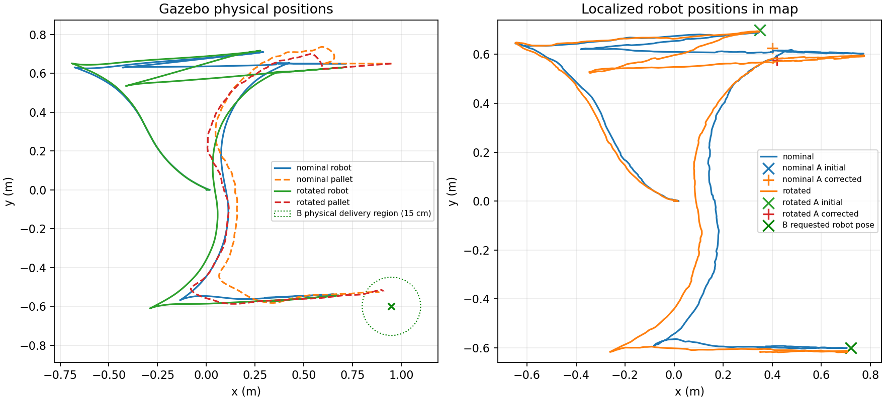

# Kết quả lấy–giao pallet với A/B từ RViz

Đây là kết quả của bản triển khai ban đầu. Bản sửa tiếp theo khôi phục pipeline
ComputePathToPose → công bố tuyến → FollowPath; xem
[báo cáo debug đường đi](../path_pipeline_fix/README.md) cho kết quả mới.

Ngày kiểm thử: 28/10/2026. ROS 2 Humble, Gazebo Fortress, controller MPPI.
Chỉ sử dụng mô phỏng; không kết nối cổng phần cứng hoặc nạp firmware.

## Kết quả cuối

- Build 10 package ROS trong `src`: đạt. Sau bản sửa planner, package navigation
  và bộ kiểm thử C++ được build/chạy lại; package RViz cũng được build lại.
- Python: **93/93** kiểm thử unit đạt, gồm hình học, validation pose, TF của scan,
  thứ tự scan/TF, hủy goal nhận ACK muộn, feedback tải và trình tự nhiệm vụ.
- C++ navigation: **4/4** executable kiểm thử đạt, có bổ sung trường hợp goal
  gần nhưng lệch ngang phải lập maneuver thay vì đoạn cuối suy biến.
- RViz: kiểm tra tên/topic của Pick A, Drop B, ba nút Run/Stop/Clear, chụp cửa sổ
  và đóng ứng dụng sạch: đạt. Dùng cấu hình `mission.rviz` riêng.
- Tám ca mô phỏng được chọn: **138/138** phép kiểm tra đạt.
- Cleanup của cả tám ca không còn tiến trình thuộc domain/partition của lượt thử.

| Ca thử | Phép kiểm tra đạt | Kết quả |
|---|---:|---|
| [A sơ bộ bị lệch](nominal/checks.json) | 22/22 | LiDAR sửa goal, lấy–giao–rút càng, DONE |
| [Pallet xoay](rotated/checks.json) | 22/22 | Căn chỉnh theo mặt quan sát, lấy–giao thành công |
| [Hủy khi đang mang tải](cancel_loaded/checks.json) | 13/13 | Dừng, giữ tải, không tự chạy lại |
| [Hủy khi rút càng ở B](cancel_retreat/checks.json) | 13/13 | Dừng và báo CANCELED |
| [Mất scan](scan_loss/checks.json) | 13/13 | Dừng và khóa nhiệm vụ do lỗi feedback/navigation |
| [Không có pallet](missing_pallet/checks.json) | 13/13 | Không chèn/nâng; báo không xác nhận được pallet |
| [Hủy lúc nhận dạng](cancel/checks.json) | 13/13 | Dừng và báo CANCELED |
| [Hồi quy a_to_b cũ](legacy/checks.json) | 29/29 | Giữ tuyến đã duyệt, lấy–giao và về Home |

Các ca A/B còn kiểm tra từ chối chạy khi chưa chọn đủ pose, pose sai frame,
lệnh chạy trùng và xóa A/B khi đang chạy. Dữ liệu ground truth chỉ vào checker;
controller không đăng ký pose pallet/robot từ Gazebo.

## Số đo trong hai lượt hoàn chỉnh

A được chọn tại `(0.35, 0.70, yaw=0.06)` thay vì trạm danh nghĩa
`(0.35, 0.65, yaw=0)`. B là pose **robot** `(0.72, -0.60, yaw=0)`.
Pallet xoay trong ca thứ hai thêm 0,08 rad.

| Số đo | Ca thường | Pallet xoay |
|---|---:|---:|
| Sai số robot so với B trong map lúc hạ | 1,54 cm | 2,10 cm |
| Sai số pallet vật lý so với vị trí dự kiến ở B | 9,77 cm | 8,80 cm |
| Quãng rút sau thả | 35,11 cm | 35,06 cm |
| Khoảng hở nhỏ nhất của hai đầu càng so với mặt vào pallet sau rút | 15,22 cm | 15,18 cm |

Khoảng hở cuối được tính độc lập từ pose vật lý của robot/pallet và hình học
hai càng, xem [physical_clearance.json](validation/physical_clearance.json).
Ca hủy có tải vẫn có tiếp xúc/tải và pallet cao khoảng 8,1 mm so với nền khi dừng.



**Sai số trong map không phải sai số đặt hàng vật lý.** B hiện là vùng trống,
không có mốc docking tại đó. Bộ kiểm tra xác nhận goal map trong 4 cm và
0,06 rad, đồng thời đo riêng vị trí pallet trong vùng giao hàng bán kính 15 cm.
Kết quả này không nghiệm thu độ chính xác vật lý 4 cm hoặc 7 cm. Muốn chính xác
hơn ở B cần mốc quan sát và bước căn chỉnh tương đối tại trạm thả.
Nhận dạng tại A dựa trên mặt có kích thước biết trước, không phải nhận dạng
mọi loại pallet hoặc tự phát hiện mọi cấu trúc lỗ càng.

## Các lỗi phát hiện và giới hạn còn lại

Các lượt trước khi chốt kết quả không bị bỏ khỏi ghi nhận:

- Scan có thể đến trước TF tương ứng. Bản đầu tiêu thụ timestamp quá sớm và
  không tích lũy đủ mẫu. Đã sửa retry cùng scan khi TF tới, bổ sung unit test.
- Goal sửa chủ yếu lệch ngang và gần robot có thể làm planner tạo đoạn cuối
  gần zero và lặp recovery. Đã sửa điều kiện nối terminal leg, bổ sung test C++.
- Smoke test mở panel Navigation 2 cũ trong domain rỗng gặp lỗi khi đóng thread.
  Giao diện nhiệm vụ dùng panel riêng trong `mission.rviz`; đã kiểm tra đóng sạch.
- Một lượt prototype đo sai số B khoảng 9,3 cm, không đạt phép kiểm tra vật lý
  7 cm. Các số đo cuối ở trên công bố rõ giới hạn đặt hàng theo AMCL.
- Có lượt khởi động bị `ACTUATOR_NOT_READY`, và một lượt khác dừng sớm do
  `FEEDBACK_STALE` của nâng trước khi kịp tiêm ca hủy. Không tăng hoặc bỏ watchdog,
  không tự chạy lại nhiệm vụ sau lỗi. Nguyên nhân trễ phản hồi thoáng qua chưa
  được xác định đầy đủ; các ca cuối được chạy riêng lại và đạt. Chưa nghiệm thu
  độ bền nhiều chu kỳ.

Tóm tắt các lượt lỗi ở [debug_trials.json](validation/debug_trials.json).
Log thô của các lượt phát triển còn ở `results/dynamic_mission/` trên máy này.

Lệnh `colcon build` quét cả workspace phát hiện bộ test firmware native cũ trong
`firmware/esp32/tests/core_tests.cpp` không biên dịch vì tham chiếu `Watchdog`
đã bị bỏ khỏi enum. Firmware không được sửa trong công việc này. Đây là lỗi
còn lại của bộ test ngoài `src`, không được tính là đạt; xem
[log build firmware](validation/optional_firmware_build_failure.log).
Build toàn bộ phần ROS bằng `colcon build --base-paths src --symlink-install`
đã đạt. Các test runtime mapping không thuộc phạm vi kiểm thử mới này.

Robot thật chưa chạy nghiệm thu chu trình tự động. Đầu vào nâng đang dùng preset
xung chưa phù hợp với hợp đồng chiều cao của mission; cần hiệu chuẩn và backend
position, TF/geometry đúng, cùng feedback tải thật có heartbeat trước khi chạy.

## Chạy và đối chiếu

Xem [hướng dẫn thao tác và tích hợp](../../../docs/dynamic_mission.md).

```bash
source /opt/ros/humble/setup.bash
colcon build --base-paths src --symlink-install
source install/setup.bash
ros2 launch forklift_bringup p6.launch.py
```

Trong RViz: **Pick A → Drop B → Run mission**.

Mỗi thư mục ca thử có CSV chuyển động, checks, summary, cấu hình run, cleanup
và checksum đầu vào. [summary.json](summary.json) giữ số đếm đầy đủ.
Checksum các nguồn controller/planner đã được đối chiếu với code cuối của cả
các ca động và hồi quy. [source_manifest.json](source_manifest.json) ghi thêm
các file triển khai/tài liệu thay đổi trong workspace.

[Log Python](validation/python_tests.log), [log C++](validation/cpp_tests.log),
[log build ROS](validation/ros_build.log), [log build planner](validation/planner_build.log),
[kết quả RViz](validation/ui_result.json), [ảnh giao diện RViz](validation/rviz.png).
