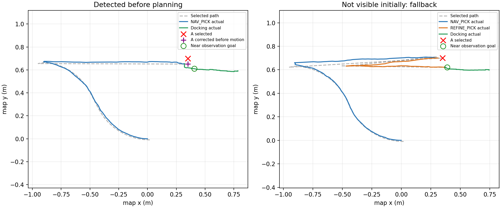

# Nhận dạng pallet ngay lúc Run

ROS 2 Humble, Gazebo Fortress, MPPI; chỉ dùng mô phỏng ở domain/partition riêng,
không điều khiển phiên terminal đang chạy của người dùng hoặc phần cứng.

## Hành vi mới

Trước PLAN_MISSION và trước khi bánh xe chạy, robot thử nhận dạng trong 2 giây,
dùng 5 scan mới có TF theo timestamp, kiểm tra độ ổn định và giới hạn hiệu chỉnh.
Nếu nhận dạng được, NAV_PICK đầu tiên đi tới A đã sửa. Nếu chưa quan sát được
hoặc sửa quá giới hạn, robot dùng A sơ bộ rồi thử lại khi đến đó. Lệnh hủy và
lỗi sensor/readiness vẫn dừng nhiệm vụ, không chuyển thành nhánh fallback.

Khi tới gần, robot bắt buộc xác nhận lại bằng 5 scan. Với nhánh nhận dạng sớm,
pose robot hiện tại được so trong hệ trục pallet: tối đa 15 cm dọc, 6 cm ngang,
0,10 rad góc có thể dùng docking sau khi Nav2 kiểm tra footprint trên đoạn quay,
căn ngang và tiến đến preinsert. Nếu vượt ngưỡng hoặc đường căn chỉnh bị chặn,
robot lập REFINE_PICK. Các ngưỡng ALIGN/INSERT, watchdog và xử lý tải không đổi.
Nhánh fallback giữ tiêu chí replan cũ: thay đổi A trên 2,5 cm hoặc 0,04 rad.

Cách tạo tuyến bốn profile, công thức chọn tuyến, FollowPath và mã controller
giữ nguyên bản đã chạy ổn định. Thêm `pickup_goal_checker` riêng 6 cm/0,10 rad
cho NAV_PICK động để bàn giao cho LiDAR khi tới vị trí đứng trước pallet;
B, REFINE_PICK và nhiệm vụ cũ giữ checker 3,5 cm/0,05 rad. Một lượt kẹt
cuối NAV_PICK trước thay đổi này được giữ ở
[navigation_stall](initial_trials/navigation_stall/checks.json).
`initial_detection` ghi kết quả đầu;
`refinement` ghi kết quả xác nhận gần, lỗi vị trí tương đối và quyết định replan.

## AMCL và điều kiện bỏ chặng hiệu chỉnh

Nhận dạng sớm cung cấp tọa độ pallet trong map theo định vị lúc đó. Nếu AMCL
đổi ước lượng trong lúc robot di chuyển, hoặc pallet dịch chuyển, xác nhận gần
vẫn có thể yêu cầu REFINE_PICK. Hai lượt thử đầu đã hoàn tất lấy–giao nhưng
không đạt phép kiểm tra thử nghiệm giả định luôn bỏ được REFINE_PICK; dữ liệu
được giữ trong [initial_trials](initial_trials/README.md). Bản kiểm thử cuối
phân biệt trường hợp đã định vị trước, khởi động mới và target bị dịch chuyển.

Ca `early_direct` yêu cầu 8 cập nhật scan khi đứng yên qua service AMCL trước
Run, tạo một ca có thêm cập nhật định vị trước khi bắt đầu. Việc bỏ REFINE_PICK
vẫn phải đạt ngưỡng sai lệch đo được và kiểm tra footprint. Đây là thiết lập của checker, không thêm
vào controller; không đưa pose Gazebo vào AMCL. Service được đối chiếu với
[mã AMCL Humble](https://github.com/ros-navigation/navigation2/blob/humble/nav2_amcl/src/amcl_node.cpp).
Các ca khác khởi động như P6 bình thường, không thêm bước cập nhật này.



Trái: đi tới A hiệu chỉnh từ path đầu tiên rồi docking; không có REFINE_PICK.
Phải: chưa thấy pallet ở đầu, đi A sơ bộ rồi thêm chặng REFINE_PICK khi nhận
dạng lại. Hình ghi vị trí robot trong map, không phải ground truth vật lý.

## Chạy lại

Build package đã thay đổi, dừng launch cũ rồi source và mở lại:

```bash
cd /home/thanh/ros_ws/forklift
source /opt/ros/humble/setup.bash
colcon build --base-paths src --packages-select forklift_navigation forklift_task_manager forklift_bringup --symlink-install
source install/setup.bash
ros2 launch forklift_bringup p6.launch.py
```

Chọn A sơ bộ trước pallet và B như trước. Trong P6 có thể dùng
A `(0.35, 0.70, yaw=0.06)`, B `(0.72, -0.60, yaw=0)`.
`DETECT_PICK_INITIAL` chạy trước PLAN_MISSION; `DETECT_PICK` vẫn xuất hiện ở gần.
Tham số node `initial_detection_timeout` mặc định 2 s, miền 0–5 s; 0 tắt thử sớm.
Hướng dẫn đầy đủ: [dynamic_mission.md](../../../docs/dynamic_mission.md).

## Đối chiếu nhánh tiếp cận đã chạy

| Ca | Nhận dạng đầu | Có REFINE_PICK |
|---|---|---|
| Nhận dạng sớm, không REFINE_PICK | DETECTED | Không |
| Chưa thấy pallet lúc đầu | UNAVAILABLE | Có |
| Pallet đổi vị trí sau nhận dạng | DETECTED | Có |
| Khởi động mới, A lệch | DETECTED | Không |
| B của người dùng | DETECTED | Không |
| Pallet xoay | DETECTED | Không |

## Kết quả bàn giao

- Build ba package thay đổi đạt; Python unit **117/117**, C++ navigation **4/4 executable** đạt.
- Mô phỏng: **373/373 phép kiểm tra đạt**, **16/16 ca**. Các lượt đều cleanup sạch.
- Checksum nguồn production trong cả 16 lượt giống nhau và khớp workspace hiện tại. Mã controller và config cơ sở khớp bản trước; navigation launch thêm goal checker NAV_PICK riêng. Xem [audit](verification_audit.json).

| Ca | Đạt | Kết quả |
|---|---:|---|
| [Nhận dạng sớm, không REFINE_PICK](early_direct/checks.json) | 32/32 | SUCCEEDED |
| [Chưa thấy pallet lúc đầu](early_fallback/checks.json) | 31/31 | SUCCEEDED |
| [Pallet đổi vị trí sau nhận dạng](moved_pallet/checks.json) | 32/32 | SUCCEEDED |
| [Khởi động mới, A lệch](nominal/checks.json) | 31/31 | SUCCEEDED |
| [B của người dùng](user_drop/checks.json) | 31/31 | SUCCEEDED |
| [Pallet xoay](rotated/checks.json) | 31/31 | SUCCEEDED |
| [Nhiệm vụ a_to_b cũ](legacy/checks.json) | 29/29 | SUCCEEDED; về Home |
| [A không khả thi](invalid_pick/checks.json) | 15/15 | NO_VALID_PATH_NAV_PICK |
| [B bị chặn](invalid_drop/checks.json) | 15/15 | NO_VALID_PATH_NAV_DROP |
| [Hủy lúc nhận dạng sớm](cancel_initial/checks.json) | 18/18 | CANCELED |
| [Mất scan lúc nhận dạng sớm](scan_loss_initial/checks.json) | 18/18 | FEEDBACK_OR_NAVIGATION_FAULT |
| [Hủy khi xác nhận gần](cancel/checks.json) | 18/18 | CANCELED |
| [Mất scan lúc ALIGN](scan_loss/checks.json) | 18/18 | FEEDBACK_OR_NAVIGATION_FAULT |
| [Không có pallet](missing_pallet/checks.json) | 18/18 | PALLET_DETECTION_NOT_STABLE |
| [Hủy khi mang tải](cancel_loaded/checks.json) | 18/18 | CANCELED |
| [Hủy khi rút càng ở B](cancel_retreat/checks.json) | 18/18 | CANCELED |

Ca lỗi/hủy đạt khi dừng đúng mã lỗi và khóa tự chạy lại. Hủy ở bước nhận dạng sớm còn kiểm tra không fallback, không lập path và không chạy bánh. Hủy mang tải giữ trạng thái có tải; hủy sau thả giữ trạng thái đã nhả tải.

Các ca lấy–giao kiểm tra điểm cuối path đầu khớp A đã hiệu chỉnh trong 5 mm, route trước chuyển động, năm scan xác nhận gần, footprint đoạn docking khi bỏ REFINE_PICK, căn chỉnh vật lý, chở tải, thả đúng goal map và lùi rút càng.

[Log Python](python_tests.log), [log C++](cpp_tests.log), [log trạng thái](mission_events.log), [lệnh chạy lại](verification_commands.md). Sai số đặt hàng vật lý vẫn phụ thuộc định vị; xem giới hạn ở hướng dẫn vận hành.
