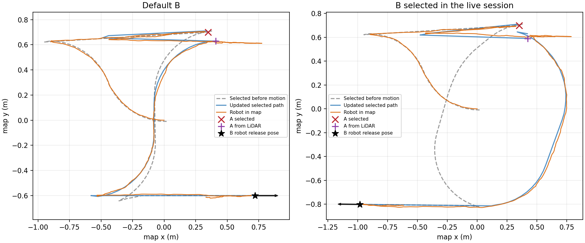

# Debug Run không có path và robot chạy recovery

Ngày 28/10/2026; ROS 2 Humble, Gazebo Fortress, MPPI. Chỉ thử mô phỏng,
không kết nối phần cứng. Phiên P6 đang chạy của người dùng ở domain 1 chỉ được
đọc topic/TF/log; các lượt thử dùng domain và Gazebo partition riêng.

## Nguyên nhân có bằng chứng

[Snapshot phiên đang lỗi](live_session_readonly.json) cho thấy `ACTION_FAILED_6`
ở NAV_PICK, `route_ready=false`, hai path rỗng, nhưng navigation READY và càng
đã homing. Nhánh A/B lúc đó gửi `NavigateToPose`, khác pipeline tuyến cũ.

A người dùng chọn là pose robot `(0.892022, 0.570133, -0.087618 rad)`, quá sát
pallet trong world P6. [Log gốc](live_failure_excerpt.log) báo
`Goal-aligned approach corridor or connecting path is blocked`, rồi behavior
server chạy spin 1,57 rad, backup và spin lần nữa trước khi goal thất bại.

Sau khi khôi phục tuyến cũ, một lượt thử đầy đủ phát hiện thêm MPPI không sửa
được hướng tại điểm chuyển từ lùi sang tiến trong NAV_DROP. Lượt lỗi này được
giữ lại ở [before_cusp_fix](before_cusp_fix/summary.json), không tính vào các
phép kiểm tra đạt của bản cuối.

Hồi quy tiếp theo phát hiện việc chỉnh góc ở khoảng cách 10 cm có thể dừng
robot ngoài vùng đổi chiều 8 cm của MPPI. Bản cuối chỉ bắt đầu chỉnh góc khi
cách điểm đổi chiều dưới 7 cm. [Lượt hồi quy bị lỗi](before_cusp_position_fix/summary.json)
được lưu riêng để đối chiếu, cũng không tính vào kết quả bản cuối.

Một [lượt tiếp theo](before_final_goal_fix/summary.json) đã giao hàng và về gần
Home nhưng còn lệch ngang tại đích cuối. Bản cuối phân biệt điểm đổi chiều và
đích cuối: chỉ chỉnh góc ở đích cuối khi vị trí nằm trong 80% ngưỡng goal checker.
Pose goal và path được so trong cùng frame/timestamp, theo cách
[PathHandler của Nav2 Humble](https://github.com/ros-navigation/navigation2/blob/humble/nav2_mppi_controller/src/path_handler.cpp)
biến đổi path. Không nới ngưỡng goal checker hay điều kiện kiểm thử.

[Ca lặp với B của người dùng](before_join_curvature_fix/summary.json) phát hiện
đoạn nối Bezier ở REFINE_PICK chỉ dài 15,3 cm nhưng đổi hướng tổng 2,47 rad.
Đoạn này không bám được theo bán kính quay cấu hình 0,5 m. Planner nay kiểm
tra độ cong đoạn nối trước khi chọn; nếu vượt giới hạn thì lập maneuver qua
điểm vào hành lang. Tọa độ thực của trường hợp này được thêm vào kiểm thử C++.

## Thay đổi

- A/B động dùng `ComputePathToPose` với bốn profile của script preview cũ,
  cùng hàm thống kê/chọn ứng viên; công bố toàn tuyến rồi gửi `FollowPath`.
- Kiểm tra cả A và B với footprint có tải trước khi chạy bánh. Goal không khả
  thi báo `NO_VALID_PATH_NAV_PICK`/`NO_VALID_PATH_NAV_DROP`; không chạy BT recovery.
- LiDAR vẫn sửa pose A; lập lại path hiệu chỉnh và chặng B từ pose thực.
  Đoạn nối hiệu chỉnh phải đạt giới hạn độ cong của xe.
- RViz hiển thị toàn tuyến và path đang bám; ẩn `/plan` chứa các ứng viên.
- MPPI dừng tịnh tiến trước khi sửa góc ở cuối đoạn/điểm đổi chiều, dùng hướng
  thân xe kể cả khi lùi, kiểm tra footprint trong phép quay rồi tiếp tục tuyến.
  Các kiểm tra corridor, collision và feedback vẫn được giữ.
- Nhiệm vụ trạm cố định `a_to_b` vẫn dùng tuyến đã duyệt và về Home.

## Chạy lại ở terminal

Bản sửa đã được build trong workspace. Dừng launch cũ bằng Ctrl+C rồi chạy:

```bash
cd /home/thanh/ros_ws/forklift
source /opt/ros/humble/setup.bash
source install/setup.bash
ros2 launch forklift_bringup p6.launch.py
```

Trong world P6, chọn A là pose đứng trước pallet, ví dụ `(0.35, 0.70, yaw=0.06)`;
B có thể là `(0.72, -0.60, yaw=0)` hoặc B đã chọn trong phiên debug
`(-0.982239, -0.801960, yaw=3.130279)`. Đây là pose robot, không phải tâm pallet.
Các tọa độ này chỉ áp dụng cho world P6.

Xem [hướng dẫn vận hành](../../../docs/dynamic_mission.md) để biết hợp đồng
cảm biến và giới hạn độ chính xác; các kết quả mô phỏng không xác nhận robot thật.

## Path và độ chính xác của ba ca hoàn tất



Đường xám: tuyến công bố trước chuyển động; xanh: tuyến cập nhật; cam: robot trong map. Các đoạn lùi có trong tuyến đã chọn.

| Ca | Sai số robot tại B trong map | Sai số pallet vật lý so với tâm giao dự kiến | Rút càng |
|---|---:|---:|---:|
| B mặc định | 2.75 cm | 9.04 cm | 35.09 cm |
| B của người dùng | 2.55 cm | 2.16 cm | 35.07 cm |
| Pallet xoay | 2.76 cm | 8.46 cm | 35.06 cm |

Sai số trong map và sai số vật lý là hai phép đo khác nhau. B không có mốc docking cục bộ; kết quả trên không phải cam kết sai số đặt hàng ngoài thực tế.

## Kết quả kiểm thử của bản được bàn giao

- Build **10 package ROS** trong `src` đạt; navigation được build lại sau thay đổi cuối.
- Python unit: **100/100 đạt**; C++ navigation: **4/4 executable đạt**.
- Mô phỏng: **220/220 phép kiểm tra đạt** trong **11 ca**; cleanup không còn tiến trình của từng lượt.
- Static preview cũ đạt; ca tái hiện đoạn nối 15,3 cm nay tạo maneuver **1,71 m**, có một điểm đổi chiều.
- Checksum của nguồn được chụp trong cả 11 lượt giống nhau và khớp nguồn hiện tại; xem [audit](verification_audit.json).

| Ca thử | Đạt | Trạng thái cuối |
|---|---:|---|
| [A sơ bộ bị lệch, B mặc định](nominal/checks.json) | 26/26 | SUCCEEDED |
| [B của người dùng](user_drop/checks.json) | 26/26 | SUCCEEDED |
| [Pallet xoay](rotated/checks.json) | 26/26 | SUCCEEDED |
| [Nhiệm vụ a_to_b cũ, về Home](legacy/checks.json) | 29/29 | SUCCEEDED; về Home |
| [A gây lỗi trong phiên live](invalid_pick/checks.json) | 14/14 | NO_VALID_PATH_NAV_PICK |
| [B bị chặn](invalid_drop/checks.json) | 14/14 | NO_VALID_PATH_NAV_DROP |
| [Hủy khi nhận dạng](cancel/checks.json) | 17/17 | CANCELED |
| [Mất scan khi căn chỉnh](scan_loss/checks.json) | 17/17 | FEEDBACK_OR_NAVIGATION_FAULT |
| [Không có pallet](missing_pallet/checks.json) | 17/17 | PALLET_DETECTION_NOT_STABLE |
| [Hủy khi mang tải](cancel_loaded/checks.json) | 17/17 | CANCELED |
| [Hủy khi rút càng ở B](cancel_retreat/checks.json) | 17/17 | CANCELED |

Các ca lỗi/hủy đạt khi hệ thống dừng, báo đúng lỗi và khóa việc tự chạy lại.
Các ca đầy đủ còn kiểm tra path trước chuyển động, chọn profile cũ, active path, không gọi NavigateToPose recovery, sửa A bằng LiDAR, chèn thẳng, chở pallet thật trong mô phỏng, thả và rút càng.

[Lệnh chạy lại](verification_commands.md), [log Python](python_tests.log), [log C++](cpp_tests.log), [log controller](controller_events.log), [tái hiện đoạn nối](static_preview/short_join_regression.json).
